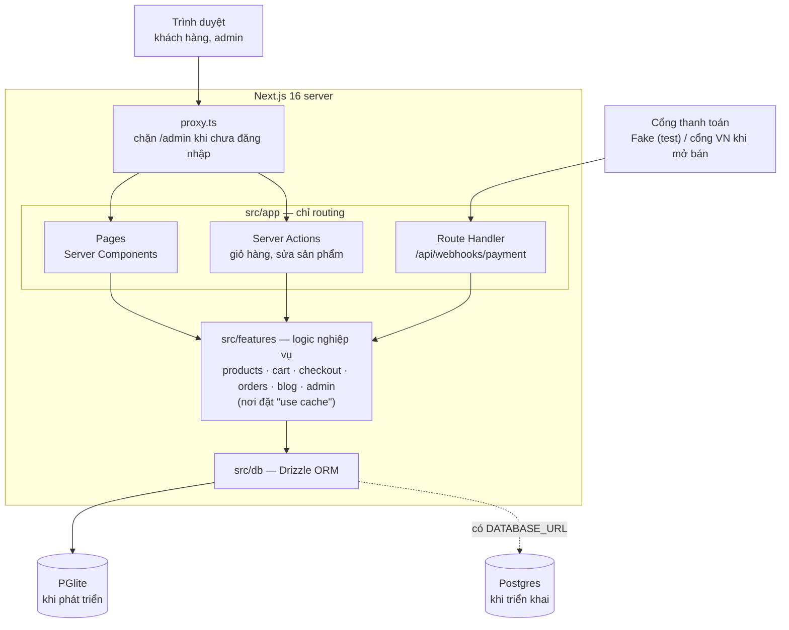
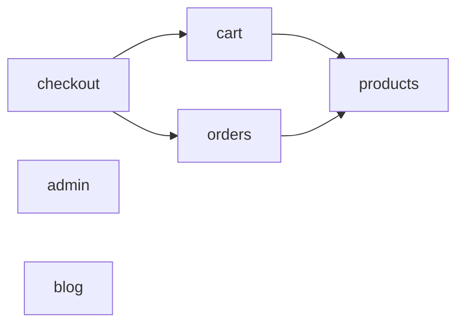
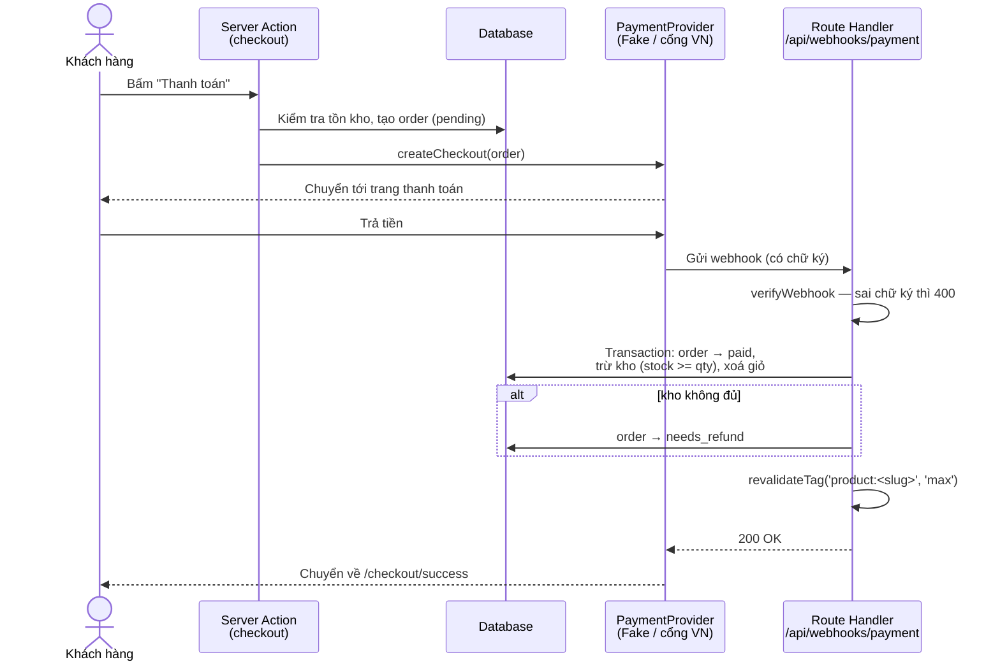
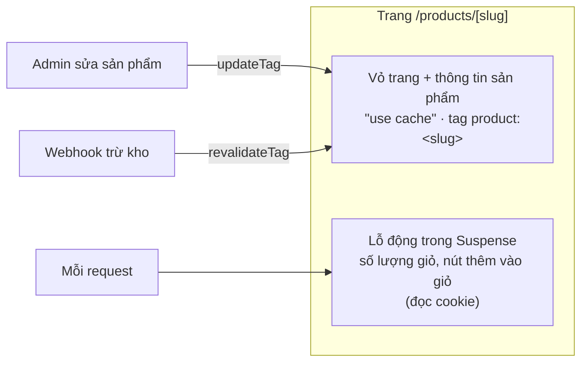
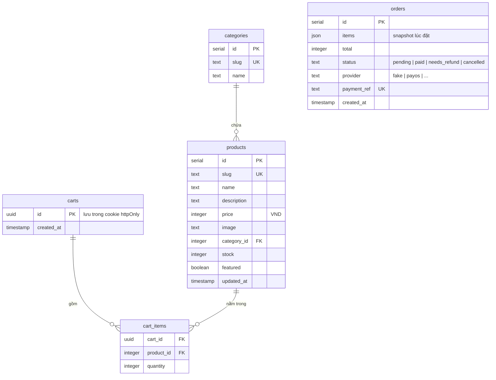
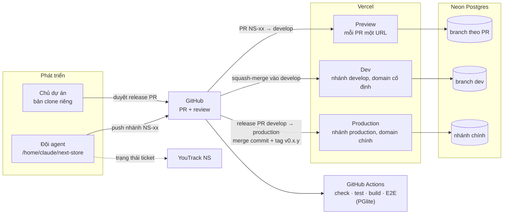

# Kiến trúc: next-store

Tài liệu này cho cái nhìn bằng hình. Chi tiết và lý do nằm trong [`design.md`](./design.md) và [`adr/`](./adr). Sơ đồ viết bằng Mermaid, xem được trên GitHub, GitLab, YouTrack và VS Code (cài extension Markdown Preview Mermaid).

## 1. Tổng quan các lớp

Không có backend riêng: server Next.js vừa render giao diện vừa là backend. Mũi tên chỉ đi một chiều từ trên xuống; dependency-cruiser kiểm tra quy tắc này (`npm run check:deps`).

## 2. Các miền nghiệp vụ (`src/features`)

Mỗi miền chỉ lộ ra ngoài qua `index.ts`. Mũi tên là "được phép import".

| Miền | Trách nhiệm | Mốc |
|---|---|---|
| `products` | Đọc danh mục, danh sách, chi tiết; ghi sản phẩm (kèm `updateTag`) | M1, M2, M5 |
| `blog` | Đọc file MDX, metadata bài viết | M3 |
| `cart` | Cookie giỏ hàng, thêm / sửa / xoá, kiểm tra tồn kho | M4 |
| `admin` | Phiên đăng nhập admin (ký / xác minh cookie) | M5 |
| `checkout` | `PaymentProvider`, tạo phiên thanh toán | M6 |
| `orders` | Tạo đơn, xử lý webhook, trừ kho, danh sách đơn | M6 |

## 3. Luồng thanh toán

`paymentRef` là unique: webhook gửi lặp lại chỉ được xử lý một lần.

## 4. Luồng cache

- Phần vỏ và dữ liệu sản phẩm được phục vụ từ cache cho đến khi có sự kiện làm mới.
- Phần phụ thuộc cookie luôn được tính lại cho từng người xem.
- Blog được tạo tĩnh lúc build, không cần làm mới.

## 5. Mô hình dữ liệu

`orders` lưu bản chụp sản phẩm (`items`) thay vì tham chiếu, để đơn cũ không đổi khi giá sản phẩm thay đổi. Bảng `carts`, `cart_items` thêm ở M4; `orders` ở M6.

## 6. Môi trường và luồng deploy

- `main` đóng băng, không deploy. Ticket PR vào `develop`; cuối mốc, release PR `develop → production`. Hotfix: `hotfix/NS-xx-…` từ `production`, sau đó back-merge vào `develop`. Chi tiết: [ADR-0006](./adr/0006-branch-strategy.md).
- Local và CI dùng PGlite; preview, Dev và production dùng Neon. Chi tiết: [ADR-0005](./adr/0005-hosting.md).
- Đội agent làm việc trong `/home/claude/next-store` (máy ảo Linux); chủ dự án không chạy `npm` ở thư mục đó mà dùng bản clone riêng.
