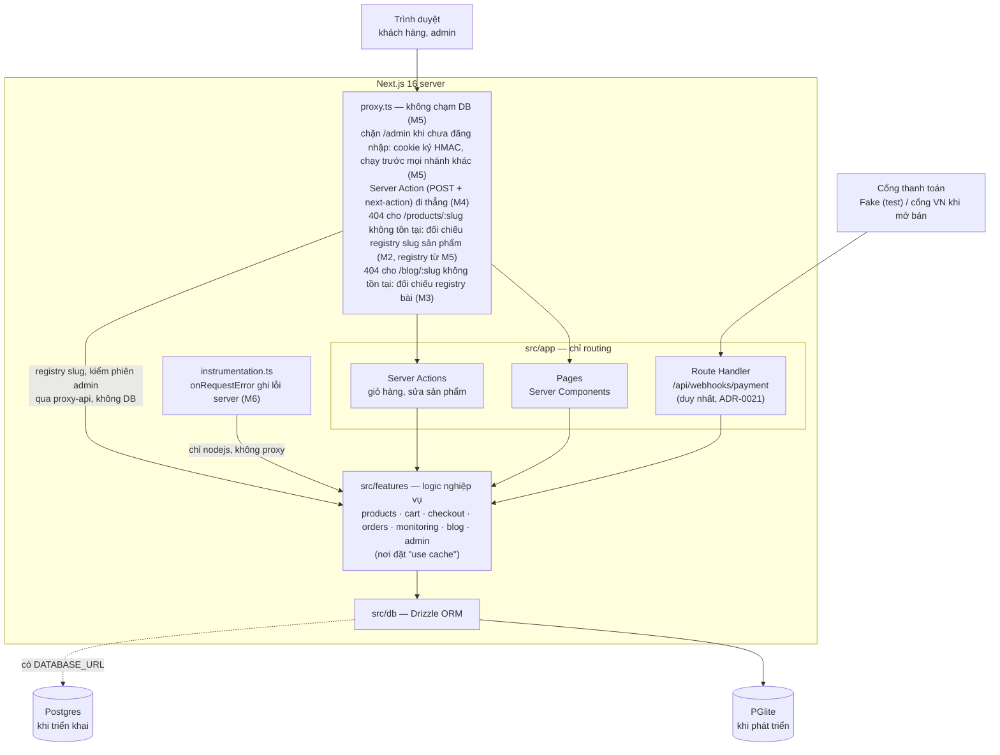
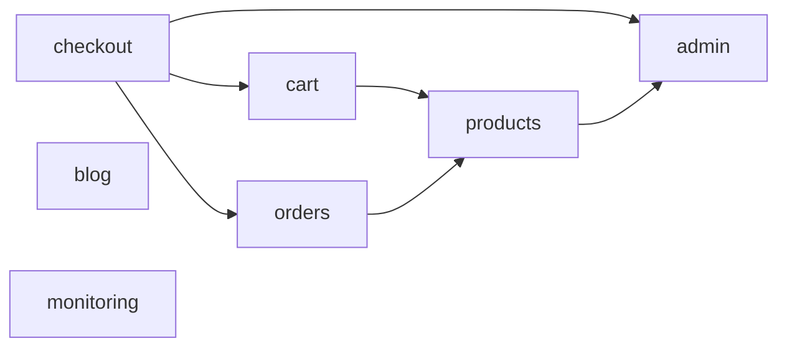
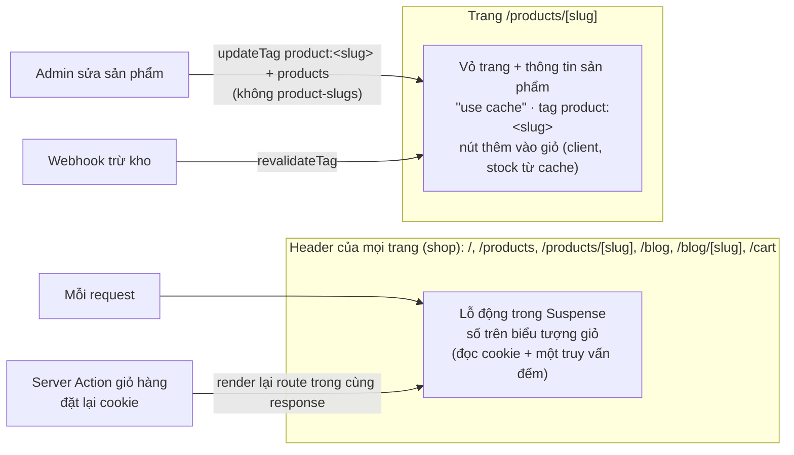
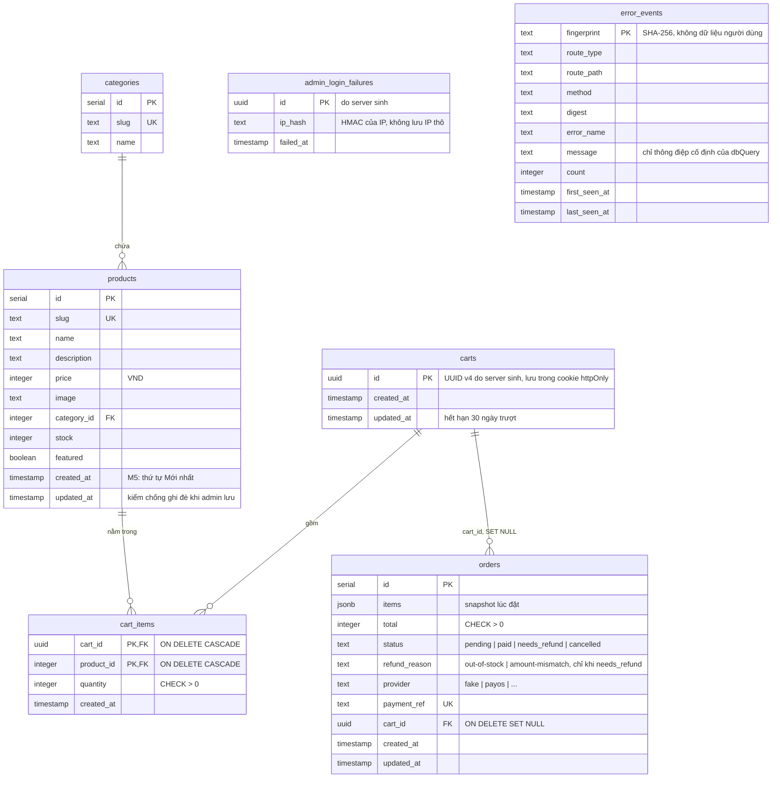
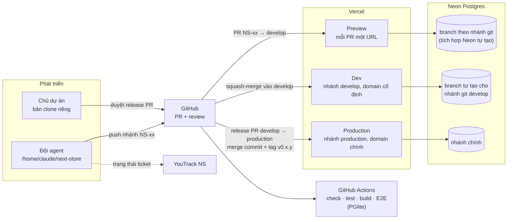

# Kiến trúc: next-store

Tài liệu này cho cái nhìn bằng hình. Chi tiết và lý do nằm trong [`design.md`](./design.md) và [`adr/`](./adr). Sơ đồ viết bằng Mermaid, xem được trên GitHub, GitLab, YouTrack và VS Code (cài extension Markdown Preview Mermaid).

## 1. Tổng quan các lớp

Không có backend riêng: server Next.js vừa render giao diện vừa là backend. Mũi tên chỉ đi một chiều từ trên xuống; dependency-cruiser kiểm tra quy tắc này (`npm run check:deps`).



## 2. Các miền nghiệp vụ (`src/features`)

Mỗi miền chỉ lộ ra ngoài qua `index.ts`; riêng phần admin của `products`, `orders` và `monitoring` lộ qua `admin.ts`, chỉ `src/app/admin/**` import (audit PR #108 M-1; M6: [ADR-0023](./adr/0023-admin-orders-and-password-strength.md)). Mũi tên là "được phép import".



| Miền | Trách nhiệm | Mốc |
|---|---|---|
| `products` | Đọc danh mục, danh sách, chi tiết; registry slug cho proxy (`catalog-slugs.ts`, M5); ghi sản phẩm (kèm `updateTag` theo `tagsForProductWrite`, [ADR-0019](./adr/0019-product-edits-and-cache-tags.md)); đọc admin (`admin-queries.ts`), bảng `/admin/products` và form sửa sản phẩm (`components/product-edit-form.tsx`, client), cả ba qua lối vào `admin.ts`, không qua `index.ts` — kiểm phiên bằng `hasAdminSession` của `admin`, nên chiều là `products → admin`, không ngược lại (audit PR #107 M-2) | M1, M2, M5 |
| `blog` | Registry bài viết (`posts.ts`, không import gì), nội dung MDX (`content.ts`), metadata bài viết | M3 |
| `cart` | Cookie giỏ hàng, thêm / sửa / xoá, kiểm tra tồn kho | M4 |
| `admin` | Cấu hình và mật khẩu admin, phiên đăng nhập (ký / xác minh cookie HMAC), giới hạn đăng nhập sai, thanh admin; không import miền nào khác. CSP nonce cho `/admin` ([ADR-0018](./adr/0018-admin-auth.md), [ADR-0020](./adr/0020-content-security-policy-and-hsts.md)) | M5 |
| `checkout` | `PaymentProvider`, `FakeProvider`, chữ ký webhook (`signature.ts`), xử lý webhook (`webhook.ts`), cấu hình fail-closed, cửa thanh toán thử `checkoutAccess` (gọi `hasAdminSession`, nên có chiều `checkout → admin`), Server Action bắt đầu thanh toán, cổng thử nghiệm ([ADR-0021](./adr/0021-payment-orders-and-webhook.md)) | M6 |
| `orders` | Tạo đơn, áp sự kiện thanh toán, trừ kho, đọc đơn của khách; danh sách đơn cho admin qua `admin.ts` ([ADR-0021](./adr/0021-payment-orders-and-webhook.md), [ADR-0023](./adr/0023-admin-orders-and-password-strength.md)) | M6 |
| `monitoring` | Ghi lỗi server (`onRequestError`) vào `error_events`, không dữ liệu người dùng; danh sách lỗi cho admin qua `admin.ts`; không import miền nào khác ([ADR-0022](./adr/0022-error-tracking-and-web-vitals.md)) | M6 |

## 3. Luồng thanh toán

Chi tiết và lý do: [ADR-0021](./adr/0021-payment-orders-and-webhook.md). Ở Production, `TEST_PAYMENTS_ACCESS` không đặt nên chỉ phiên admin đi hết luồng này; khách thấy "Thanh toán chưa mở.".

```mermaid
sequenceDiagram
  actor K as Khách hàng (trình duyệt)
  participant A as Server Action<br/>(checkout)
  participant DB as Database
  participant P as FakeProvider<br/>(/checkout/test)
  participant W as Route Handler<br/>/api/webhooks/payment

  K->>A: Bấm "Thanh toán"
  A->>DB: Kiểm tra tồn kho, tạo order (pending, giá chụp vào items)
  A->>P: createCheckout(order)
  A-->>K: Chuyển tới /checkout/test?ref=…
  K->>A: Bấm "Thanh toán thành công" (fakeGatewayAction)
  A-->>K: Sự kiện đã ký (thân + chữ ký), không ghi DB
  K->>W: fetch POST sự kiện đã ký
  W->>W: Thân ≤ 8 KB, verifyWebhook — sai chữ ký thì 400, trước mọi đọc DB
  W->>DB: Transaction: khoá order theo paymentRef;<br/>không còn pending thì "đã xử lý";<br/>đủ kho: trừ kho (stock >= qty), order → paid, xoá giỏ
  alt kho không đủ
    W->>DB: không trừ dòng nào, order → needs_refund, giỏ giữ
  end
  W->>W: revalidateTag('product:<slug>', 'max')
  W-->>K: 200 OK
  K->>K: Chuyển sang /checkout/success
```

Cổng thật (khi mở bán) tự gọi `/api/webhooks/payment` từ server của nó thay cho bước trình duyệt chuyển tiếp; phần từ `W` trở xuống không đổi. `paymentRef` là unique: webhook gửi lặp lại chỉ được xử lý một lần.

## 4. Luồng cache



- Phần vỏ và dữ liệu sản phẩm được phục vụ từ cache cho đến khi có sự kiện làm mới.
- Danh sách slug (`getCatalogSlugs`) mà mọi trang chi tiết đọc mang tag riêng `product-slugs` (M5). Admin sửa một sản phẩm chỉ xoá `product:<slug>` và `products` (danh sách), nên trang của các sản phẩm khác không bị render lại; `product-slugs` chỉ bị xoá khi tập slug đổi ([ADR-0019](./adr/0019-product-edits-and-cache-tags.md)).
- Phần phụ thuộc cookie luôn được tính lại cho từng người xem. Từ M4 đó là số trên biểu tượng giỏ ở header của **mọi** trang `(shop)`; vỏ trang vẫn prerender, lỗi DB chỉ làm mất con số. Dữ liệu giỏ không bao giờ nằm trong `"use cache"` ([ADR-0014](./adr/0014-cart-storage-and-cookie.md)).
- Server Action của giỏ không gọi `updateTag`: M4 không sửa tồn kho. Đặt lại cookie làm Next.js render lại route hiện tại, nên biểu tượng giỏ cập nhật trong cùng response.
- Blog được tạo tĩnh lúc build, không cần làm mới; chỉ lỗ biểu tượng giỏ ở header là động.

## 5. Mô hình dữ liệu



`orders` lưu bản chụp sản phẩm (`items`) thay vì tham chiếu, để đơn cũ không đổi khi giá sản phẩm thay đổi. Bảng `carts`, `cart_items` thêm ở M4; `products.created_at` và `admin_login_failures` (không quan hệ với bảng khác) ở M5 ([ADR-0018](./adr/0018-admin-auth.md), [ADR-0019](./adr/0019-product-edits-and-cache-tags.md)); `orders` và `error_events` ở M6 ([ADR-0021](./adr/0021-payment-orders-and-webhook.md), [ADR-0022](./adr/0022-error-tracking-and-web-vitals.md); `error_events` không quan hệ với bảng khác). Khi có tính năng xoá sản phẩm: ẩn bằng `products.archived_at`, không xoá cứng (ADR-0019). Giỏ không lưu giá: luôn dùng giá hiện tại, M6 chụp giá vào `orders.items` lúc tạo đơn ([ADR-0014](./adr/0014-cart-storage-and-cookie.md)).

## 6. Môi trường và luồng deploy



- `main` đóng băng, không deploy. Ticket PR vào `develop`; cuối mốc, release PR `develop → production`. Hotfix: `hotfix/NS-xx-…` từ `production`, sau đó back-merge vào `develop`. Chi tiết: [ADR-0006](./adr/0006-branch-strategy.md).
- Local và CI dùng PGlite; preview, Dev và production dùng Neon. Chi tiết: [ADR-0005](./adr/0005-hosting.md).
- Đội agent làm việc trong `/home/claude/next-store` (máy ảo Linux); chủ dự án không chạy `npm` ở thư mục đó mà dùng bản clone riêng.
