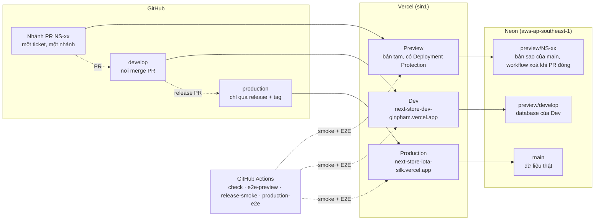
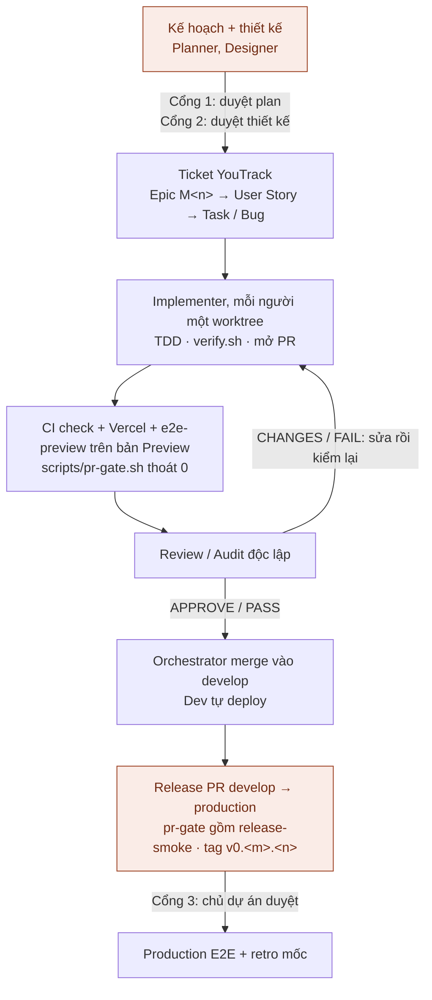

# Toàn cảnh: hạ tầng và quy trình

Đọc trang này trước tiên khi quay lại dự án sau một thời gian. Nó cho thấy code chạy ở đâu, dữ liệu nằm ở đâu, và một thay đổi đi từ ticket tới production như thế nào. Chi tiết nằm ở [`architecture.md`](./architecture.md) (bên trong ứng dụng), [`process.md`](./process.md) (vai trò, quy tắc) và các [ADR](./adr).

GitHub hiển thị các sơ đồ dưới đây trực tiếp (Mermaid). Muốn sửa thì sửa text trong file này.

## 1. Hạ tầng: nhánh → môi trường → database

- **Một chiều:** code chỉ đi PR → `develop` → `production`. `main` đóng băng ([ADR-0006](./adr/0006-branch-strategy.md)). `production` chỉ đổi qua release PR (merge commit) + tag `v0.<mốc>.<n>`, có chủ dự án duyệt.
- **Preview:** mỗi lần đẩy code lên một PR, Vercel build và deploy riêng PR đó ra một URL tạm, chạy đúng hạ tầng như production nhưng tách biệt hoàn toàn. Hỏng thì chỉ hỏng bản tạm. Deployment Protection chặn người ngoài; CI vượt qua bằng header bypass, header này chỉ gửi tới đúng origin ([NS-54](./plans/M3.md)).
- **Nhánh database preview:** tích hợp Neon tự tạo nhánh `preview/<tên nhánh git>`, là bản sao của `main`, để migration và seed của PR chạy trên bản sao, không chạm dữ liệu thật ([ADR-0007](./adr/0007-dev-neon-branch.md)).
  - Gói Free chỉ có **10 nhánh**, và tích hợp **không** tự xoá nhánh khi PR đóng. Đủ 10 nhánh thì deploy preview báo `Resource provisioning failed`.
  - Workflow `neon-preview-cleanup.yml` (NS-111) xoá `preview/<nhánh>` khi PR đóng và quét hằng ngày, luôn giữ `main` và `preview/develop` (`process.md` §4). Cần secret `NEON_API_KEY` của chủ dự án (`process.md` §8).
  - [ADR-0010](./adr/0010-app-role-and-preview-data.md) (M3 Task 5) chuyển preview sang một project Neon riêng không có dữ liệu khách.
- **Region:** function chạy ở `sin1` cạnh Neon (`vercel.json`). Proxy (`src/proxy.ts`) thì chạy ở edge gần người truy cập; xem [ADR-0009](./adr/0009-product-404-in-proxy.md) và NS-79.
- **CI** (`.github/workflows/`):
  - `ci.yml` (`check`): typecheck, lint, test.
  - `preview-e2e.yml` (`e2e-preview`): smoke và E2E trên mỗi bản Preview và Dev, kích hoạt bởi `deployment_status`; deploy lỗi thì job này **skipped**.
  - `release-gate.yml` (`release-smoke`, NS-111): trên PR vào `production`, smoke trên bản Dev của đúng head commit và smoke với lookup DB của proxy luôn fail-open (như Production), đều với `SMOKE_PRODUCT_FAIL_OPEN=warn`.
  - `neon-preview-cleanup.yml`: dọn nhánh Neon preview.
  - `production-e2e.yml`: chạy sau mỗi release, chỉ đọc, có bộ chặn ghi.
- **Role database:** runtime dần chuyển sang role `next_store_app`, chỉ có quyền DML; migration chạy bằng role chủ ([ADR-0010](./adr/0010-app-role-and-preview-data.md)).

## 2. Quy trình một mốc

- **Ô cam là cổng của chủ dự án:**
  - Cổng 1: duyệt plan và mục "Cần chủ dự án quyết".
  - Cổng 2: duyệt thiết kế.
  - Cổng 3: duyệt release.

  Ngoài ra, chủ dự án tự làm mọi việc cần mật khẩu hoặc secret (biến Sensitive trên Vercel, Rotate Secrets, API key), duyệt ADR, và đồng ý trước khi xoá dữ liệu.
- **Orchestrator** điều phối:
  - tạo ticket (`scripts/youtrack/ticket.py`) và worktree (`/home/claude/wt/NS-xx`);
  - giao việc cho agent;
  - merge khi `scripts/pr-gate.sh <n>` thoát 0 (skipped không phải là qua) và PR đã được review hoặc audit;
  - dọn tay nhánh Neon khi workflow dọn nhánh fail;
  - mở release PR, chạy pr-gate trên nó (gồm `release-smoke`) rồi mới xin Cổng 3.
- **YouTrack:** Epic `M<n>` → User Story (`US-xx`, hoặc story kỹ thuật `M<n>-TECH`) → Task / Bug, nối bằng link **subtask of**. Board Development xếp thẻ theo User Story ([`process.md`](./process.md) §3).
- **Vòng sửa:** Reviewer hoặc Auditor trả `CHANGES` / `FAIL` thì Implementer sửa trên cùng PR, rồi được kiểm lại. Phát hiện mức thấp được ghi thành ticket riêng, không chặn merge.
- **Sau release:** ticket đã lên production chuyển Done. Hết mốc thì làm retro ([`retro/`](./retro)).
