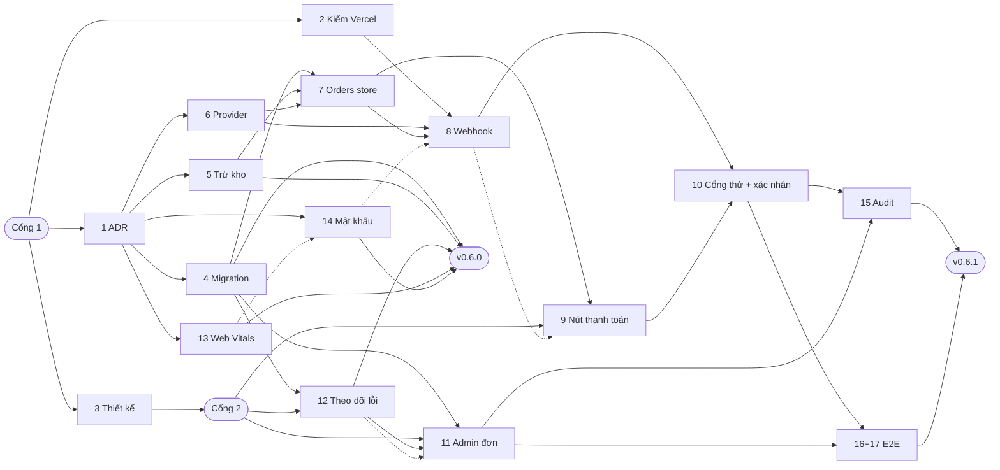

# M6 Thanh toán & vận hành — Implementation Plan

> **Cho agent thực hiện:** làm từng task theo `docs/process.md` (một ticket = một nhánh `NS-xx-…` = một PR, mỗi người viết một worktree `/home/claude/wt/NS-xx`). Các bước dùng checkbox (`- [ ]`) để theo dõi. Chỉ đọc task của mình và block Interfaces của task liên quan. **Cổng 1 chưa qua:** mọi chỗ ghi "(quyết định N)" theo **đề xuất** ở mục "Cần chủ dự án quyết"; chủ dự án chọn khác thì Planner sửa task bị ảnh hưởng trước khi Orchestrator tạo ticket.

**Goal:** Khách có giỏ hợp lệ bấm "Thanh toán", qua cổng thử nghiệm (không thu tiền), thanh toán thành công thì đơn chuyển `paid`, tồn kho giảm đúng số lượng, giỏ trống, và khách thấy trang xác nhận có mã đơn. Webhook gửi lặp lại cùng một thanh toán chỉ trừ kho một lần; hai người cùng mua món cuối thì đơn sau chuyển `needs_refund` (US-09). Admin mở `/admin/orders` thấy đơn mới nhất trước, lọc theo trạng thái, đơn `needs_refund` nổi bật (US-14). Cùng mốc: lỗi server trên Production được ghi lại và admin xem được (`requirements.md` §5 "Vận hành"); Web Vitals đo trên Production theo ngưỡng NFR hiệu năng; các việc M5 chuyển sang (trừ kho đặt `updated_at`, đơn 0 ₫, CSP cho cổng thanh toán, độ mạnh `ADMIN_PASSWORD`, C6 trên Vercel). Production là cửa hàng công khai thật: ở đó chỉ phiên admin được bắt đầu và xác nhận thanh toán thử, khách thấy "Thanh toán chưa mở.", để không ai "mua" miễn phí làm cạn tồn kho thật hay làm ngập bảng `orders` (quyết định 14). Không thu tiền thật, không thông tin giao hàng, không email (`requirements.md` §6, §7).

**Architecture:** Hai miền mới theo `architecture.md` §2: `checkout` (interface `PaymentProvider` của ADR-0004, `FakeProvider`, Server Action bắt đầu thanh toán, cổng thử nghiệm, xử lý webhook) và `orders` (tạo đơn, áp sự kiện thanh toán, trừ kho, danh sách đơn). Chiều phụ thuộc giữ đúng sơ đồ: `checkout → cart`, `checkout → orders`, `orders → products`; kiểu `PaymentEvent` nằm ở `orders` để `orders` không phải import `checkout`. **Route handler đầu tiên của repo:** `src/app/api/webhooks/payment/route.ts`, mỏng, gọi `handlePaymentWebhook` của `checkout`; ADR-0021 (Task 1) ghi đây là route handler **duy nhất** được phép (ngoài route metadata `sitemap.xml`, `robots.txt`, ảnh OG), kiểm bằng test tĩnh và bằng manifest sau `next build`. Webhook xác minh chữ ký (HMAC-SHA256 bằng `FAKE_PAYMENT_SECRET`, `crypto.subtle.verify`, hạn 5 phút) **trước** mọi đọc DB, rồi trong **một** transaction: khoá hàng `orders` theo `payment_ref`, đơn không còn `pending` thì trả "đã xử lý" (idempotent), khoá các hàng `products` của đơn theo thứ tự `id`, đủ kho thì trừ cả đơn (đặt `updated_at = now()`, ADR-0019), đổi đơn sang `paid`, xoá `cart_items` của giỏ; thiếu một dòng thì không trừ dòng nào và đơn sang `needs_refund` (quyết định 3). Sau commit: `revalidateTag(tag, 'max')` cho `tagsForProductWrite({ slug, change: 'fields' })` của từng sản phẩm (ADR-0003; route handler không gọi được `updateTag`). **FakeProvider:** trang `/checkout/test?ref=<paymentRef>` có nhãn "Môi trường thử nghiệm — không thu tiền"; nút bấm gọi một Server Action ký sự kiện ở server, trình duyệt chuyển tiếp nó bằng `fetch` tới `/api/webhooks/payment` (quyết định 2): webhook đi qua đúng HTTP như cổng thật, không cần server tự gọi chính nó qua lớp bảo vệ của Vercel. Giá chụp vào `orders.items` (jsonb) lúc tạo đơn (ADR-0014 (c)). **Cửa thanh toán thử** (quyết định 14A): biến `TEST_PAYMENTS_ACCESS` (`public` | `admin`; trống hay giá trị lạ → `admin`, fail-closed) quyết ai được dùng FakeProvider; `admin` thì `checkoutAccess()` đòi `hasAdminSession()` ở bốn chỗ: ô thanh toán của `/cart`, `startCheckoutAction`, trang `/checkout/test`, `fakeGatewayAction`. Production không đặt biến (= `admin`); Preview / Dev và local đặt `public`. Theo biến môi trường, không theo `VERCEL_ENV` (design.md §7: code không kiểm tên môi trường). **Vận hành:** `src/instrumentation.ts` `onRequestError` (Next.js 16.4.6) ghi một dòng log cố định (không header, không cookie, không query) và upsert bảng `error_events` (gộp theo dấu vân tay, trần 500 hàng, tối đa 30 lần ghi / phút mỗi instance); admin xem ở `/admin/errors` (quyết định 8). Web Vitals đo tổng hợp trên Production bằng Playwright (mobile, CPU 4×, mạng chậm qua CDP; LCP / CLS / INP, p75 của 5 lần) sau mỗi release và hằng tuần, không thư viện, không tài khoản (quyết định 9).

**Tech Stack** (kiểm bằng `npm view` ngày 2026-11-26: `next` latest = 16.4.6): giữ nguyên M5 — next 16.4.6, react 19.3.1, zod 4.6.7, drizzle-orm 0.45.4, drizzle-kit 0.31.11, postgres 4.1.1, @playwright/test 1.65.1. **Không thêm thư viện nào** ở các phương án đề xuất. HMAC dùng Web Crypto (`crypto.subtle`) như phiên admin. Chỉ khi chủ dự án chọn phương án khác A mới cần thư viện (đánh dấu "cần chủ dự án duyệt"): `@vercel/speed-insights` 2.1.0 (9D; 9B dùng thẻ script HTML, không cần gói), `@sentry/nextjs` 11.18.0 (peer `next ^16.0.0-0`, 8C).

**Spec:** `docs/requirements.md` (US-09, US-14; §5 Hiệu năng "Web Vitals đo trên production (M6)", Đúng dữ liệu "webhook thanh toán chỉ xử lý mỗi đơn một lần", Bảo mật "webhook xác minh chữ ký", Sẵn sàng thanh toán thật, Vận hành "lỗi production được ghi nhận và báo về"; §6, §7), `docs/design.md` (§4 `orders`, §5 Thanh toán, §6, §8 M6), `docs/architecture.md` (§2 `checkout`, `orders`; §3 luồng thanh toán; §5 ER), `docs/design-system.md` (dòng "Thanh toán sẽ mở…" của `/cart`, nav admin "Đơn hàng"), `docs/conventions.md` (§1, §2 route handler chỉ cho webhook, khu admin; §7; §10), `docs/process.md` (mục "Quy tắc từ retro M5"), ADR-0002, 0003, 0004, 0005, 0009, 0010, 0011, 0014, 0015, 0016, 0018, 0019, 0020, `docs/plans/M5.md` ("Chuyển sang M6"), `docs/retro/M5.md` ("Theo dõi sang M6"), `docs/audits/M5.md` ("Chưa kiểm được"), ticket NS-6, NS-61, NS-114, NS-131.

## Điều đã đọc trong tài liệu đúng phiên bản

Môi trường lập plan không dựng nguyên mẫu (build và Playwright phải qua `scripts/verify.sh`). Những điều dưới đây đọc từ `node_modules/next/dist/docs` của next 16.4.6 (bản cài ở `/home/claude/next-store`), từ code `develop` tại `40d4b8b`, và từ tài liệu Vercel / Neon (đọc 2026-11-26). Điều **chưa kiểm** nằm ở bảng sau và có bước kiểm tại chỗ.

| # | Điều đã đọc | Nguồn |
|---|---|---|
| D1 | `src/instrumentation.ts` export `onRequestError(error, request, context)`; `request` có `path` (gồm query), `method`, **`headers` đầy đủ** (gồm `cookie`); `context.routeType` là `'render' \| 'route' \| 'action' \| 'proxy'`, `context.routePath` là đường dẫn file route (`/app/products/[slug]`). `error` có thể là lỗi đã qua React, đọc `digest`. Tác vụ async phải được `await`. | `03-api-reference/03-file-conventions/instrumentation.md` |
| D2 | `revalidateTag(tag, profile)` gọi được trong Server Function và Route Handler; `'max'` = stale-while-revalidate (request kế tiếp nhận bản cũ và kích hoạt làm mới); `{ expire: 0 }` = không phục vụ bản cũ. Một tham số là deprecated. `updateTag` **chỉ** trong Server Action. | `04-functions/revalidateTag.md`, `04-functions/updateTag.md` |
| D3 | Speed Insights **miễn phí** trên mọi gói: 10.000 sự kiện / 30 ngày trượt cho cả team; chạm hạn mức thì **dừng thu ít nhất 14 ngày**; gói miễn phí **chỉ có điểm RES**, không có từng chỉ số LCP / CLS / INP (cần Speed Insights Plus, chỉ Pro, 10 USD / project / tháng). Có cách nhúng bằng thẻ `<script>` HTML, không cần gói npm; script và điểm thu nằm cùng origin (`/<unique-path>/script.js`, `/_vercel/speed-insights/*`). | [Speed Insights — Limits and Pricing](https://vercel.com/docs/speed-insights/limits-and-pricing); [Speed Insights — Quickstart](https://vercel.com/docs/speed-insights/quickstart) |
| D4 | Observability trên Hobby: giữ dữ liệu 12 giờ; runtime log **1 giờ**; Query, cảnh báo (alerts) chỉ có ở Observability Plus (Pro / Enterprise). Hobby không có cách "báo về" sẵn. | [Observability Plus — Limitations](https://vercel.com/docs/observability/observability-plus) |
| D5 | Neon Free: 10 nhánh / project (đủ 10 thì tạo nhánh thất bại); **100 CU-giờ / project / tháng**, vượt thì compute bị treo tới kỳ sau; scale-to-zero sau 5 phút, không tắt được; 1 GB / project. Mỗi lần ghi từ trình duyệt (ví dụ thu Web Vitals vào DB) đánh thức compute. | [Neon — Free plan limits and quotas](https://neon.com/faqs/free-plan-limits-and-quotas) |
| D6 | Hobby mỗi tháng: 1.000.000 Function invocation, 4 CPU-giờ; WAF 3 custom rule nhưng **một** quy tắc rate limit (đã dùng cho Server Action, ADR-0015); vượt hạn mức thường phải chờ 30 ngày. | plan M5 D13; ADR-0015 |
| D7 | **Code hiện tại:** `src/features/cart/components/cart-view.tsx` dòng 123 có câu "Thanh toán sẽ mở trong bản cập nhật tới." (comment: M6 đặt nút primary "Thanh toán" `w-full md:w-auto` đúng chỗ). Giỏ đọc giá hiện tại (ADR-0014 4A); `src/features/cart/store.ts` khoá hàng `carts` bằng `SELECT … FOR UPDATE` trước mọi ghi. `.env.example` đã có `PAYMENT_PROVIDER=fake`, `FAKE_PAYMENT_SECRET` ("Bắt buộc từ M6"). | code `develop` `40d4b8b` |
| D8 | **Code hiện tại:** `products.updated_at` có `$onUpdate` nhưng form admin so `updated_at` lúc mở form (ADR-0019 13A); câu trừ kho của M6 phải đặt `updated_at = now()` rõ ràng (ADR-0019 Hệ quả, audit PR #107 L-4). `cacheTag` của trang chi tiết là `product:<slug>` + `product-slugs`; thẻ sản phẩm trong danh sách hiện "Hết hàng" nên cần cả `products`. | `src/db/schema.ts`; ADR-0019; `product-card.tsx` |
| D9 | **Quy tắc hiện có:** `conventions.md` §2 "Route Handler chỉ dùng cho request từ bên ngoài (webhook)"; `src/admin-session-checks.test.ts` cấm `route.*` dưới `/admin`. Quy tắc WAF `ns-95-cart-action-rate-limit` chỉ đếm `POST` **có** header `next-action` (ADR-0015, đọc lại 2026-11-25), nên webhook (không có header đó) không bị đếm. CSP nền có `form-action 'self'`, `connect-src 'self'`, không có `frame-src` ngoài nguồn thanh công cụ của Preview (ADR-0020). Role app có `USAGE / SELECT` trên sequence (ADR-0010), nên `orders.id serial` (mã đơn số nguyên, ADR-0004) chạy được với role app. | `conventions.md`; ADR-0010, 0015, 0020 |
| D10 | `dbQuery` ném lỗi với thông điệp cố định `database query failed: <tên> (<SQLSTATE>)` hoặc `database query timed out: <tên>` (ADR-0011); đây là thông điệp duy nhất được phép lưu vào `error_events`. `playwright.config.ts` khởi thêm `next start` với env khác (`BROKEN_DB_URL`, `HUNG_DB_URL`) khi chạy local / CI: chỗ để test cấu hình đóng (fail-closed) trên build thật. | `src/db/query.ts`; `playwright.config.ts` |
| D11 | `npm view` (2026-11-26): `next` 16.4.6; `@vercel/speed-insights` 2.1.0; `@sentry/nextjs` 11.18.0, `peerDependencies.next = ^14.0 \|\| ^15.0.0-rc.0 \|\| ^16.0.0-0`. | `npm view` |

**Chưa kiểm** (task được giao kiểm tại chỗ trước khi viết code phụ thuộc; kết quả khác dự kiến → dừng, báo Orchestrator, Planner sửa plan):

| # | Giả định | Kiểm ở |
|---|---|---|
| C1 | (C6 của M5, audit #105 L2) `headers()` trong Server Action trên Vercel có `x-forwarded-for` là **một** IP do Vercel đặt; giá trị client tự gửi (`x-forwarded-for: 1.2.3.4`) bị ghi đè. | Task 2 Step 1 |
| C2 | Trên Preview / Dev (có Vercel Authentication), `fetch` POST cùng origin từ trang đã mở tới `/api/webhooks/payment` tới được route handler (cookie bảo vệ của trình duyệt đi theo); fixture `request` của `e2e/test.ts` (header bypass) cũng tới được; Production không có lớp bảo vệ. | Task 2 Step 2 |
| C3 | `onRequestError` chạy trên Vercel cho lỗi render và lỗi route handler, dòng log hiện trong Runtime Logs; nó **không** chạy cho lỗi đã bị bắt (`dbQuery` trong action giỏ trả `unavailable`). | Task 2 Step 3; Task 12 Step 1 |
| C4 | `src/instrumentation.ts` có bị gộp vào bundle của proxy không. Nếu có, phần ghi DB chỉ được nạp bằng `import()` động khi `context.routeType !== 'proxy'`, và bundle proxy không kéo `@/db` (đo kích thước bundle proxy trong `.next/server` trước / sau). | Task 12 Step 1 |
| C5 | `revalidateTag(tag, 'max')` gọi từ route handler dưới Cache Components làm `product:<slug>` cũ: lần tải đầu sau đó trả bản cũ, lần sau có tồn kho mới; `/products/<khác>` vẫn `x-nextjs-cache: HIT` (local) / `x-vercel-cache: HIT` (Vercel). | Task 8 Step 1; Task 16 Step 1 |
| C6 | Form `startCheckoutAction` gửi **trước** khi hydrate nhận 303 sang `/checkout/test?ref=…` (cùng origin, `form-action 'self'` cho qua); sau hydrate, `redirect()` của action điều hướng phía client. Không có vi phạm CSP. | Task 9 Step 1 |
| C7 | `SELECT … FOR UPDATE` trên `orders` rồi `products` (theo `id`) và `jsonb` của Drizzle chạy giống nhau trên PGlite và Postgres; PGlite tuần tự hoá transaction nên test đồng thời trên PGlite chỉ chứng minh logic, không chứng minh khoá (ghi ở "Ước lượng rủi ro"). | Task 4 Step 1; Task 7 |
| C9 | Cookie `__Host-ns_admin` (`SameSite=Strict`, `Path=/`) đi theo khi admin mở `/cart` và `/checkout/test` (gõ URL, bấm link từ `/admin`), nên `checkoutAccess()` thấy phiên; action id của `startCheckoutAction` / `fakeGatewayAction` giống nhau giữa các `next start` của cùng một build (để E2E lấy id từ server `public` gọi thẳng vào server `admin`). | Task 9 Step 1 |
| C8 | Playwright trên runner GitHub: `newCDPSession` đặt được `Emulation.setCPUThrottlingRate` (4) và `Network.emulateNetworkConditions`; `PerformanceObserver` lấy được `largest-contentful-paint`, `layout-shift`, `event` (`durationThreshold: 16`) trên Chromium; số đo ổn định giữa các lần (độ lệch < 20 %). | Task 13 Step 1 |

## Global Constraints

Mỗi quy tắc bảo vệ ghi kèm **test chạy trên build thật** (`next build` + `next start`: E2E của `verify.sh full` / CI, smoke, hoặc `check:bundle` sau build), theo quy tắc 2 của retro M5. Test tĩnh / Vitest là lớp thêm, không thay.

- **Worktree, PR, verify:** như M5 — mỗi task một worktree `/home/claude/wt/NS-<số>`; commit Conventional Commits có mã ticket cuối dòng đầu và dòng attribution của phiên; PR bằng REST vào `develop` (`process.md` §5); `bash scripts/verify.sh quick|full`, mã thoát 3 → `verify.sh wait`; dán dòng `::pass / ::fail / ::skip` thật vào PR; mỗi PR có một dòng `model: <Haiku|Sonnet|Opus>` trong comment bằng chứng (quy tắc 5). Hai task song song không dùng chung cổng (`E2E_PORT`).
- **Cổng merge:** Orchestrator chỉ merge khi `bash scripts/pr-gate.sh <số PR>` thoát 0, dán output vào comment bằng chứng; skipped không phải là qua.
- **Neon (D5):** tối đa **5 PR M6 mở cùng lúc** (Free 10 nhánh: `main`, `preview/develop`, mỗi PR một nhánh, chừa chỗ). Task 2 là PR nháp: đóng (không merge) ngay khi xong để workflow dọn nhánh.
- **Role DB:** chạy được với **cả hai** cấu hình của ADR-0010 (NS-61 còn dở). Runtime chỉ DML. Ngoại lệ có chủ ý: `orders.id serial` (mã đơn số nguyên gửi cổng, ADR-0004; role app có quyền sequence, D9). `error_events` không có sequence.
- **Migration:** Task 4 là task **duy nhất** thêm `drizzle/*.sql`: một file sinh bằng `npm run db:generate`, chỉ `CREATE TABLE` / `CREATE INDEX` trên bảng mới (expand), không đổi bảng cũ. FK `orders.cart_id → carts` lấy khoá ngắn trên `carts` lúc tạo; `lock_timeout = '5s'` của `src/db/migrate.ts` (NS-101) chặn chờ lâu — build fail thì chạy lại, không sửa tay. Auditor bắt buộc. Task khác thấy cần đổi schema → dừng, báo Orchestrator.
- **DB:** ngoài `src/db` chỉ dùng `dbQuery` của `@/db`; tên truy vấn là hằng `orders.<việc>` / `checkout.<việc>` / `monitoring.<việc>`. Không `console.*` object lỗi, `cause`, SQL, header, cookie, IP, thân webhook hay chữ ký; chỉ chuỗi cố định. Ghi bị `DB_QUERY_TIMEOUT` nghĩa là không biết đã ghi hay chưa (ADR-0011): không tự thử lại; webhook trả 503 để cổng gửi lại (an toàn vì idempotent).
- **Webhook xác minh chữ ký trước mọi thứ khác** (quyết định 1A, 2A): đọc thân tối đa 8 KB (quá → 413, không parse), xác minh header `x-fake-signature` bằng `crypto.subtle.verify`, hạn 300 s, **rồi** mới Zod parse và chạm DB. Không có header hay sai → 400, không DB. *Test build:* E2E `ns-webhook.spec.ts` `webhook: không có chữ ký thì 400, đơn không đổi`, `webhook: chữ ký sai thì 400, đơn không đổi`, `webhook: thân trên 8 KB thì 413`, `webhook: sự kiện ký quá 5 phút thì 400`, `webhook: GET thì 405`; smoke `webhook-unsigned` (POST không chữ ký → 400) trên mọi môi trường, kể cả Production (Task 8).
- **Mỗi thanh toán chỉ được áp một lần** (`requirements.md` §5 Đúng dữ liệu): khoá hàng `orders` theo `payment_ref` trong transaction, đơn không còn `pending` → không ghi gì; `payment_ref` unique. *Test build:* E2E `US-09: webhook gửi lặp lại cùng một thanh toán thì tồn kho chỉ giảm một lần` (Task 16, chuyển tiếp lại đúng request đã bắt được).
- **Không bán quá tồn kho mà không bị phát hiện:** trừ kho bằng câu có điều kiện `stock >= quantity` trên hàng đã khoá; thiếu → cả đơn `needs_refund`, không dòng nào bị trừ (quyết định 3A); `CHECK stock >= 0` là lớp cuối. *Test build:* E2E `US-09: hai người cùng mua món cuối thì đơn sau chuyển needs_refund`.
- **Mọi câu trừ kho đặt `updated_at = now()`** (ADR-0019, audit PR #107 L-4), để form admin mở từ trước nhận `conflict` thay vì lưu đè số kho cũ. *Test build:* E2E `US-09: form admin mở trước khi có đơn thì lưu bị báo xung đột` (Task 16); Vitest `a checkout stock decrement moves updated_at`, `an admin form opened before a checkout gets conflict` (Task 5).
- **Tag cache khi trừ kho:** chỉ `revalidateTag(tag, 'max')` cho `tagsForProductWrite({ slug, change: 'fields' })` (= `product:<slug>`, `products`) của sản phẩm thật sự bị trừ; không bao giờ `product-slugs`, không `revalidatePath`. *Test build:* E2E `US-09: sau khi thanh toán, trang sản phẩm khác vẫn được phục vụ từ cache` (Task 16; C5).
- **Thanh toán đóng khi thiếu / yếu cấu hình (fail-closed):** `PAYMENT_PROVIDER` khác `fake` (hay trống → `fake`), `FAKE_PAYMENT_SECRET` thiếu, dưới 32 ký tự hoặc trùng `SESSION_SECRET` → nút thanh toán trả "Thanh toán chưa được cấu hình.", webhook 503, cổng thử nghiệm không ký. *Test build:* E2E `ns-closed-config.spec.ts` (server `CLOSED_CONFIG_URL`, Task 14) `closed: thiếu FAKE_PAYMENT_SECRET thì webhook trả 503` (Task 8), `closed: thiếu FAKE_PAYMENT_SECRET thì giỏ báo "Thanh toán chưa được cấu hình."` (Task 9).
- **Thanh toán thử trên Production chỉ cho admin** (quyết định 14A): `TEST_PAYMENTS_ACCESS` trim, đúng `public` mới mở cho mọi người; trống, thiếu hay giá trị khác → `admin`. Ở chế độ `admin`, `checkoutAccess()` (`src/features/checkout/access.ts`) gọi `hasAdminSession()` và **bốn lối vào** kiểm nó trước khi đọc giỏ, đọc đơn, chạm DB hay ký: ô thanh toán của `/cart` (không phiên → dòng "Thanh toán chưa mở.", không nút), `startCheckoutAction` (→ `not-open`, không ghi đơn), `/checkout/test` (→ "Thanh toán chưa mở.", không đọc đơn), `fakeGatewayAction` (→ `not-open`, không ký). Webhook không đổi (chỉ nhận sự kiện có chữ ký, mà chỉ server ký). *Test build:* E2E `ns-checkout-gate.spec.ts` (server `ADMIN_GATED_URL`, `TEST_PAYMENTS_ACCESS=admin`, local / CI) `gated: khách không có phiên admin thấy "Thanh toán chưa mở." ở giỏ và cổng thử nghiệm, không tạo đơn`, `gated: gọi thẳng startCheckoutAction và fakeGatewayAction không phiên admin thì trả not-open, không ghi, không ký`, `gated: có phiên admin thì thanh toán thử được tới trang xác nhận` (Task 9, 10); trên Production: smoke `checkout-gated` (chỉ khi `robots.txt` là `Allow: /`) và E2E chỉ đọc `US-09: trên Production khách thấy "Thanh toán chưa mở."` (Task 16).
- **Route handler duy nhất:** chỉ `src/app/api/webhooks/payment/route.ts` (ADR-0021) ngoài route metadata có sẵn (`sitemap.xml`, `robots.txt`, `opengraph-image` của `/`, `/products/[slug]`, `/blog/[slug]`). Route handler không bao giờ nằm dưới `/admin`. *Test build:* `scripts/check-route-handlers.mjs` (chạy trong `npm run check:bundle` sau `next build`): danh sách route kiểu `route` trong `.next/server/app-paths-manifest.json` đúng bằng allowlist (Task 8); thêm Vitest tĩnh `src/route-handlers.test.ts`.
- **Khu admin tự kiểm phiên ở từng lối vào** (ADR-0018, `conventions.md` §2): `/admin/orders`, `/admin/errors` là `page.tsx` dưới `(protected)` với `await requireAdminPage()` ở dòng đầu; đọc dữ liệu ở `src/features/<miền>/admin-queries.ts`, bắt đầu bằng `if (!(await hasAdminSession())) throw new Error('admin: no session')`. M6 **không** thêm Server Action admin (US-14 chỉ xem). Không route handler, không xuất CSV dưới `/admin`. *Test build:* E2E `ns-123-admin-guard.spec.ts` `NS-123: /admin/orders không phiên thì 307 tới /admin/login`, `NS-123: /admin/errors không phiên thì 307 tới /admin/login`, `NS-123: POST next-action tới /admin/orders không phiên thì 401` (Task 11, 12); `check:bundle` kiểm 3 (mọi route `/admin…` có `response: "empty"`, `htmlSize` 0) với `/admin/orders`, `/admin/errors` trong danh sách bắt buộc. Tĩnh: `src/admin-session-checks.test.ts` (không sửa luật, chỉ chạy trên file mới).
- **Bundle cửa hàng không chở code admin:** phần admin của `orders` và `monitoring` lộ qua `@/features/<miền>/admin` (`admin.ts`), chỉ `src/app/admin/**` import (dependency-cruiser `admin-entries-only-from-admin`, mở rộng từ `products-admin-entry-only-from-admin`, Task 12). *Test build:* `npm run check:bundle` (kiểm 1, 2 sẵn có) xanh sau Task 11, 12.
- **Độ mạnh `ADMIN_PASSWORD`** (quyết định 10A): ≥ 20 ký tự **và** ≥ 16 ký tự khác nhau, không thì khu admin đóng (`weak`). *Test build:* E2E `closed: mật khẩu admin yếu thì cookie phiên hợp lệ vẫn bị chuyển tới /admin/login` (Task 14).
- **CSP không nới ở M6** (quyết định 5A): FakeProvider chỉ dùng cùng origin (`/checkout/test`, `/api/webhooks/payment`), nên `form-action 'self'`, `connect-src 'self'` giữ nguyên, không thêm `frame-src`. Trang `(shop)` mới (`/checkout/test`, `/checkout/success`) không có nonce; trang admin mới dưới CSP nonce của proxy. *Test build:* E2E `ns-csp.spec.ts` `NS-csp: cổng thử nghiệm và trang xác nhận không vi phạm CSP` (Task 10), `NS-csp: /admin/orders và /admin/errors hydrate dưới CSP nonce` (Task 11, 12); smoke kiểm CSP nền (sẵn có) vẫn có `form-action 'self'`.
- **Ghi lỗi không chở dữ liệu người dùng và có trần:** `onRequestError` chỉ đọc `context.routeType`, `context.routePath`, `request.method`, `digest`, tên lớp lỗi (`[A-Za-z]{1,40}`) và thông điệp **chỉ khi** khớp mẫu cố định của `dbQuery` (D10); không bao giờ đọc `request.headers` hay `request.path`. Trần: 500 hàng, 30 lần ghi / phút mỗi instance, `routeType === 'proxy'` chỉ log (proxy không chạm DB). *Test build:* E2E `ns-monitoring.spec.ts` (server `BROKEN_DB_URL`) `monitoring: lỗi render ghi một dòng cố định, không có cookie, query hay header`, `monitoring: quá 30 lỗi một phút thì không thử ghi DB thêm` (Task 12).
- **Cache:** dữ liệu đơn và lỗi không bao giờ nằm trong `'use cache'`; trang `/checkout/*` và admin đọc DB không cache. Không thêm hàm `'use cache'` mới.
- **`"use client"`** thêm đúng: `src/features/checkout/components/checkout-button.tsx` (Task 9), `src/features/checkout/components/fake-gateway.tsx` (Task 10). Chỉ import `react`, `@/components/ui/*`, `@/lib/cn`, `@/lib/format-price`, và trong `src/features/checkout` chỉ `actions.ts`, `messages.ts`, `types.ts`. Danh sách ở `conventions.md` §2 và `src/client-files.test.ts` cập nhật cùng PR. `'use server'` mới: `src/features/checkout/actions.ts` (danh sách **shop** của `src/admin-session-checks.test.ts`).
- **Giao diện:** tiếng Việt, token của design system, vùng chạm ≥ 44 px, tiền qua `formatPrice`, thời gian qua `formatDateTime` (mới, `Asia/Ho_Chi_Minh`, Task 11). Lỗi chung trong `role="alert"`, trạng thái trong `role="status"`. Trang `/checkout/*` có `robots: noindex`.
- **E2E:** test ghi (thanh toán, huỷ, webhook) gắn `@ghi`; chạy trong project Playwright `checkout-write` (`workers: 1`, phụ thuộc mọi project khác trừ `admin-write`, chạy trước nó), dùng sản phẩm riêng `CHECKOUT_SUBJECTS` không spec nào khác dùng, trả tồn kho về seed trong `afterAll` qua admin. Test cần đặt tồn kho (món cuối, xung đột) cần `E2E_ADMIN_PASSWORD`, thiếu thì `test.skip` có lý do. Test ký sự kiện bằng tay cần `E2E_FAKE_PAYMENT_SECRET` (chỉ local / CI, `verify.sh` sinh); trên preview / Dev chỉ dùng chuyển tiếp lại request đã bắt. Production: chỉ test đọc (quyết định 13A).
- **Không dùng:** `middleware.ts`, `unstable_cache`, `revalidateTag` một tham số, `revalidatePath`, `updateTag` ngoài Server Action, thư viện thanh toán / analytics / theo dõi lỗi (ở phương án A), `localStorage` cho giỏ / đơn, route handler cho bất cứ gì ngoài webhook.
- Lùi phiên bản, thêm thư viện, lệch ADR, cần tài khoản / chi phí → dừng, báo Orchestrator.

## Thứ tự, chủ trì, phụ thuộc

| Task | Chủ trì | Model | Auditor | Designer review | Cần chủ dự án | Phụ thuộc | Song song với |
|---|---|---|---|---|---|---|---|
| 1 ADR-0021 → 0023, cập nhật tài liệu (một PR) | Implementer | Sonnet | **có** | không | duyệt ADR | Cổng 1 | 2, 3 |
| 2 Kiểm tại chỗ trên Vercel (C1, C2, C3): PR nháp, không merge | Implementer | Sonnet | không | không | không | Cổng 1 | 1, 3 |
| 3 Thiết kế màn hình M6 | Designer (+ Cổng 2) | Sonnet | không | — | **có** (Cổng 2) | Cổng 1 | 1, 2, 4–7, 13, 14 |
| 4 Migration M6: `orders`, `error_events` | Implementer | Sonnet | **có** (migration) | không | không | 1 | 5, 6, 13, 14 |
| 5 `products`: trừ kho có điều kiện, đặt `updated_at` | Implementer | Sonnet | **có** (ghi sản phẩm) | không | không | 1 | 4, 6, 13, 14 |
| 6 `checkout`: `PaymentProvider`, `FakeProvider`, chữ ký, cấu hình fail-closed | Implementer | Sonnet | **có** (chữ ký, secret) | không | `FAKE_PAYMENT_SECRET` ("Việc của chủ dự án" 1) trước khi 8 lên preview | 1 | 4, 5, 13, 14 |
| 7 `orders`: tạo đơn, áp sự kiện thanh toán (idempotent, `needs_refund`) (US-09) | Implementer | Sonnet (Opus nếu vòng 2) | **có** (dữ liệu, đồng thời) | không | không | 4, 5, 6 | 12 |
| 8 Route handler webhook, allowlist route handler (US-09) | Implementer | Sonnet | **có** (webhook) | không | không | 2 (C2), 6, 7, 14 (file) | 9 |
| 9 Nút "Thanh toán" trên `/cart`, `startCheckoutAction` (US-09) | Implementer | Sonnet | **có** (Server Action) | **có** | không | 3 (Cổng 2), 7, 8 (file) | — |
| 10 `/checkout/test` (cổng thử nghiệm), `/checkout/success` (US-09) | Implementer | Sonnet | **có** | **có** | không | 3, 8, 9 | 11 |
| 11 `/admin/orders` (US-14) | Implementer | Sonnet | **có** (admin) | **có** | không | 3, 4, 12 (file) | 10 |
| 12 Theo dõi lỗi: `onRequestError`, `error_events`, `/admin/errors` | Implementer | Sonnet | **có** (log, admin) | **có** | không | 3, 4 | 7 |
| 13 Web Vitals tổng hợp trên Production | QA | Sonnet | không | không | không | 1 | 4, 5, 6, 14 |
| 14 Độ mạnh `ADMIN_PASSWORD`; server cấu hình đóng cho E2E | Implementer | Sonnet | **có** (auth) | không | xác nhận mật khẩu ("Việc" 2) trước release | 1, 13 (file) | 4, 5, 6 |
| 15 Audit bảo mật toàn mốc M6 | Auditor | Opus | — | không | không | 4–14 đã lên Dev | — |
| 16 E2E US-09 | QA | Sonnet | không | không | không | 10 đã lên Dev | — |
| 17 E2E US-14 (chung PR với 16) | QA | Sonnet | không | không | không | 11, 16 | — |

Việc máy móc của Orchestrator (tạo ticket, chuyển trạng thái, đọc log CI, tóm tắt) giao **Haiku** (`process.md` §1).

**Đồ thị phụ thuộc** (Orchestrator chép vào ticket `M6-TECH` đầu mốc, quy tắc 3). Nét liền: phụ thuộc nội dung; nét đứt: chỉ vì chung file (làm tuần tự).

- **Đợt song song** (mỗi đợt ≤ 5 PR mở, D5): **A** sau Cổng 1: 1, 2, 3. **B** sau Task 1: 4, 5, 6, 13, 14 (13 → 14 chung `playwright.config.ts`: 14 rebase sau 13, vẫn mở cùng lúc được). **C**: 7 (sau 4, 5, 6) song song 12 (sau 4 và Cổng 2). **D**: 8 → 9 (chung file, xem dưới). **E**: 10 song song 11. **F**: 15 song song 16 + 17.
- **Xung đột file:** `playwright.config.ts`: 13 (project `vitals`) → 14 (server `CLOSED_CONFIG_URL`) → 8 (env của server đó cho webhook) → 9 (server `ADMIN_GATED_URL`) → 16 (project `checkout-write`). `e2e/ns-closed-config.spec.ts`: 14 → 8 → 9. `e2e/ns-checkout-gate.spec.ts`: 9 → 10. `scripts/smoke.sh`: 8 → 10. `scripts/check-admin-bundle.mjs` (danh sách route admin bắt buộc): 12 → 11. `.dependency-cruiser.cjs`: chỉ 12 (luật `admin-entries-only-from-admin` cho `products`, `orders`, `monitoring` một lần). `package.json`: chỉ 8 (`check:bundle` thêm `check-route-handlers.mjs`). `src/features/checkout/index.ts`: 6 → 8 → 9 → 10. `src/features/admin/components/admin-header.tsx` (nav): 12 ("Lỗi") → 11 ("Đơn hàng"). `docs/conventions.md`, `design.md`, `architecture.md`: Task 1 viết sẵn mọi quy tắc M6; task khác chỉ sửa danh sách file client (9, 10).
- **Gộp PR:** Task 1 là một PR cho ba ADR. Task 16 và 17: hai ticket, **một PR** (chung helper `e2e/checkout.ts`, chung đơn tạo ra). Task 2 không merge.
- **Story kỹ thuật:** đầu mốc, Orchestrator tạo story `M6-TECH` ("M6 — Kỹ thuật & hạ tầng"), ghi vào `issue-map.json` trước khi chạy `ticket.py tasks M6`, rồi dán đồ thị trên vào mô tả của nó. Task 1–6, 12–15 rơi vào `M6-TECH`; Task 7–10, 16 vào US-09; Task 11, 17 vào US-14. Việc follow-up `updated_at` từ retro M5 được ghi trên Epic NS-6 và làm bởi Task 5; Epic không gắn làm subtask của `M6-TECH`.
- **Release (quyết định 12A):** `v0.6.0` sớm sau khi Task 4, 5, 12, 13, 14 lên Dev: lỗi Production bắt đầu được ghi, có số Web Vitals nền trước khi thêm trang thanh toán, quy tắc mật khẩu mới áp lên Production khi chủ dự án đã xác nhận ("Việc" 2). Bảng `orders` lên cùng (expand, chưa code nào dùng). `v0.6.1` cuối mốc sau Cổng 3. Mỗi release qua `release-smoke`, sau đó `Production E2E` (có Web Vitals); ticket chỉ Done khi Production E2E xanh.

### Việc theo dõi trước và trong M6

| Ticket | Trạng thái (2026-11-26) | Quan hệ với M6 |
|---|---|---|
| **Epic NS-6** ghi việc follow-up `products.updated_at` từ retro M5 | Open | **Task 5** làm (và Task 7 dùng). |
| — CSP `form-action` / `connect-src` / `frame-src` cho cổng thanh toán (retro M5) | Tạo mới | Quyết định 5; ADR-0021; Task 10 (E2E CSP). Ticket đóng khi Task 10 merge; điều kiện cho adapter thật ghi trong ADR-0021. |
| — Độ mạnh `ADMIN_PASSWORD` (retro M5) | Tạo mới | **Task 14.** |
| — Xác nhận C6 (`x-forwarded-for` trên Vercel) đầu M6 (retro M5, audit M5 "Chưa kiểm được" 2) | Tạo mới | **Task 2 Step 1.** |
| **NS-61** project Neon riêng cho preview, role `next_store_app` | Cần chủ dự án; retro M5: "trước khi có dữ liệu đơn hàng" | Không chặn code (M6 chạy với cả hai role). Đơn M6 là đơn thử, không có thông tin khách; vẫn khuyến nghị xong trước `v0.6.1` ("Việc" 3). |
| **NS-131** phân trang danh sách sản phẩm admin (hoãn có điều kiện) | Open | Không đổi (24 sản phẩm cố định, ngưỡng trong ticket chưa tới). Danh sách **đơn** thì phân trang ngay (quyết định 6A), dùng chung `Pagination` của `products` nếu Designer đồng ý. |
| **NS-114** gỡ workaround `<title>` | Chờ Next vá | Không chặn. Form mới dùng `useHeldTitle` nếu Server Action render lại route (Task 9). |

## Review Focus

1. **Webhook trừ kho hai lần hoặc trừ khi không được.** Kiểm `status` ngoài transaction (hai lần gửi cùng thấy `pending`); không khoá hàng `orders`; trừ từng dòng rồi mới phát hiện dòng sau thiếu (để lại trừ dở); trừ kho mà không đổi `updated_at`; nhận sự kiện `paid` với `amount` khác `orders.total`; nhận sự kiện của đơn khác cùng `orderCode` nhưng khác `paymentRef`. (Task 7: Vitest `US-09: the same paid event twice decrements stock once`, `US-09: two concurrent deliveries of one event decrement stock once`, `needs_refund decrements nothing for any line when one line is short`, `an amount that differs from the total marks needs_refund (amount-mismatch) without touching stock`, `an event whose ref and order code do not match is ignored`; Task 5: `a checkout stock decrement moves updated_at`; Task 16: E2E `US-09: webhook gửi lặp lại…`, `US-09: hai người cùng mua món cuối…`)
2. **Chữ ký webhook vô dụng.** So chữ ký bằng `===`; parse JSON / chạm DB trước khi xác minh; ký trên JSON đã parse lại (khác byte với thân nhận được); không có hạn (phát lại sự kiện cũ mãi mãi — vô hại nhờ idempotent nhưng vẫn là lỗ của sự kiện `cancelled` gửi trước `paid`); thiếu `FAKE_PAYMENT_SECRET` thì ký bằng chuỗi rỗng; secret trùng `SESSION_SECRET`. (Task 6: Vitest `verifies with crypto.subtle.verify over the raw body`, `rejects a signature older than 300 seconds`, `rejects a header in any other shape without calling verify`, `refuses to sign or verify without a 32-character secret`, `is disabled when FAKE_PAYMENT_SECRET equals SESSION_SECRET`; Task 8: Vitest `does not touch the database before the signature is verified`; E2E `ns-webhook.spec.ts`)
3. **Đơn và giỏ lệch nhau.** Giá lấy lúc webhook thay vì lúc tạo đơn; tạo đơn khi giỏ có dòng vượt tồn kho (ADR-0014 10A); tạo đơn từ giỏ đã hết hạn; webhook xoá giỏ của người khác (`cart_id` lấy từ sự kiện thay vì từ đơn); huỷ thanh toán mà giỏ bị xoá; đơn 0 ₫ lọt tới cổng. (Task 7: Vitest `US-09: creates a pending order with the cart's current prices snapshotted in items`, `the snapshot keeps the old price after an admin price change`, `refuses a cart with a line over stock and writes no order`, `refuses an expired cart`, `refuses a zero total`, `a cancelled event cancels a pending order and keeps the cart`; Task 16: E2E `US-09: huỷ ở cổng thử nghiệm thì…`)
4. **Ghi lỗi làm lộ dữ liệu hoặc tự thành sự cố.** Log `request.headers` (cookie phiên admin, cookie giỏ) hay `request.path` có `?ref=`; lưu `error.message` tuỳ ý; mỗi lỗi một lần ghi DB khi DB đang chết (mỗi request thêm 5 s chờ); bảng phình không giới hạn; instrumentation kéo `@/db` vào bundle proxy. (Task 12: Vitest `never reads request headers or path`, `stores a message only when it is a fixed dbQuery message`, `stops writing after 30 records a minute in one instance`, `inserts no new fingerprint past 500 rows`, `logs only for routeType proxy`; E2E `ns-monitoring.spec.ts`; Step 1 (C4))
5. **Khu admin mới lọt kiểm phiên hoặc đọc không phân trang.** `/admin/orders` đọc DB trước `requireAdminPage`; hàm đọc ngoài `admin-queries.ts`; `?status=` / `?page=` không validate (SQL lạ, trang âm); danh sách tải mọi đơn; trang admin mới có vỏ prerender không nonce. (Task 11: Vitest `listOrdersForAdmin throws without a session before any query`, `parseOrderListParams falls back to all statuses and page 1`, `returns at most 50 orders, newest first`; E2E `NS-123: /admin/orders không phiên thì 307…`, `US-14: phân trang 50 đơn mỗi trang…`; `check:bundle` kiểm 3)
6. **Khách (hay bot) "mua" miễn phí trên Production.** FakeProvider cho ai cũng xác nhận thanh toán: bot đặt đơn liên tục làm tồn kho thật về 0 (cửa hàng hiện "Hết hàng") và làm ngập `orders` / `needs_refund`. Lỗi dễ mắc: chỉ ẩn nút ở `/cart` mà action vẫn chạy (action id là toàn cục, NS-105); kiểm ở `/checkout/test` mà quên `fakeGatewayAction`; mở mặc định khi thiếu biến; kiểm theo `VERCEL_ENV`; đọc đơn / giỏ trước khi kiểm. (Task 6: Vitest `test payments default to admin access when TEST_PAYMENTS_ACCESS is empty or unknown`; Task 9: Vitest `startCheckoutAction returns not-open without an admin session before reading the cart`; Task 10: Vitest `fakeGatewayAction returns not-open without an admin session before reading the order or signing`; E2E `ns-checkout-gate.spec.ts`; smoke `checkout-gated`)

---

### Task 1: ADR-0021 → ADR-0023, cập nhật tài liệu

**Chủ trì:** Implementer · **Model:** Sonnet · **Auditor:** **có** · **Cần chủ dự án:** duyệt ba ADR · **Phụ thuộc:** Cổng 1 · **Nhánh:** `NS-<số>-adr-m6` · **Một PR cho cả ba ADR**

**Files:**
- Create: `docs/adr/0021-payment-orders-and-webhook.md`, `docs/adr/0022-error-tracking-and-web-vitals.md`, `docs/adr/0023-admin-orders-and-password-strength.md`
- Modify: `docs/design.md` (§3 thư mục `api/webhooks/payment/route.ts` đã có; §4 bảng `orders` thêm `cart_id`, `refund_reason`, `updated_at`, bảng `error_events`; §5 Thanh toán: bước 2 "trình duyệt chuyển tiếp sự kiện ký ở server", bước 4 "không trừ dòng nào", đơn 0 ₫; §6 dòng "Trang admin, giỏ hàng, checkout"; §5 Admin: độ mạnh mật khẩu), `docs/architecture.md` (§1 thêm `instrumentation.ts`; §2 miền `monitoring`, `admin.ts` của `orders`; §3 sơ đồ tuần tự theo 2A; §5 ER `orders`, `error_events`), `docs/conventions.md` (§1 bảng file feature: `providers/`, `webhook.ts`, `signature.ts`, `admin.ts` cho `orders` / `monitoring`; §2 route handler: chỉ `src/app/api/webhooks/payment/route.ts`, test `src/route-handlers.test.ts`, `check-route-handlers.mjs`; danh sách `"use client"` để trống chỗ cho Task 9, 10 điền tên file), `docs/README.md` (mục ADR), dòng "Trạng thái" của ADR-0004 ("bổ sung bởi 0021"), ADR-0015 (Hệ quả "Webhook thanh toán (M6)": trả lời bằng quyết định 11), ADR-0018 (bổ sung bởi 0023: độ mạnh mật khẩu), ADR-0020 (Hệ quả M6: trả lời bằng quyết định 5)

**Interfaces:**
- Consumes: mục "Cần chủ dự án quyết" (sau Cổng 1), D1–D11, ADR-0002, 0004, 0014 (c), 0015, 0018, 0019, 0020.
- Produces:
  - **ADR-0021** (quyết định 1, 2, 3, 4, 5, 11, 13, 14): chỉ `FakeProvider`; cửa thanh toán thử `TEST_PAYMENTS_ACCESS` (14A: mặc định `admin`, bốn lối vào, Production không đặt biến, Preview đặt `public`; vì sao theo biến môi trường chứ không `VERCEL_ENV`; khi mở bán với cổng thật thì bỏ cửa này cùng FakeProvider trên Production); cách FakeProvider giao webhook (2A); route handler `POST /api/webhooks/payment` là route handler **duy nhất** (allowlist, test); bảng `orders` (cột ở Task 4); thuật toán áp sự kiện (Task 7) và mã trả lời (Task 8); `needs_refund` không trừ dòng nào, giữ giỏ; đơn 0 ₫ bị từ chối ở checkout; CSP không đổi, điều kiện cho adapter thật ("adapter thêm origin cổng vào `form-action` nếu cổng nhận form POST, `frame-src` nếu nhúng, `connect-src` nếu client gọi API cổng, cùng PR với adapter; kiểm lại `redirect()` sang origin ngoài từ Server Action (C6 chỉ kiểm cùng origin)"); webhook không vào quy tắc WAF (11A) và lý do; nghiệm thu Production bằng tay (13A).
  - **ADR-0022** (quyết định 8, 9): `onRequestError` + `error_events` + `/admin/errors`; trường được đọc / bị cấm (Global Constraints); trần; Web Vitals tổng hợp bằng Playwright trên Production (ngưỡng, thiết bị, throttle, p75 của 5 lần, lịch); vì sao không Speed Insights miễn phí (D3: chỉ RES), không tự thu field (D5, D6); điều kiện xét lại (mở bán / lên Pro).
  - **ADR-0023** (quyết định 6, 7, 10): `/admin/orders` (lọc, phân trang 50, không hành động trên đơn), `/admin/errors`, lối vào `admin.ts` của `orders` / `monitoring`; luật mật khẩu ≥ 20 ký tự và ≥ 16 ký tự khác nhau (bổ sung ADR-0018 5A); cách sinh và cách chủ dự án tự kiểm (README).
- [ ] **Step 1:** Viết ba ADR theo mẫu ADR-0019 / 0020 (Bối cảnh với "Điều đã đọc", bảng phương án, Quyết định chép nguyên văn câu trả lời Cổng 1, Hệ quả, Cách kiểm trỏ tới tên test của plan này).
- [ ] **Step 2:** Sửa tài liệu theo danh sách Files; kiểm mọi link tương đối mở được.
- [ ] **Step 3: Verify** — `bash scripts/verify.sh quick` → `::pass` (lint markdown nếu có; `check` không đổi).
- [ ] **Step 4:** Commit `docs(adr): payment, orders, error tracking, admin orders NS-<số>`, PR.

---

### Task 2: Kiểm tại chỗ trên Vercel (C1, C2, C3) — PR nháp

**Chủ trì:** Implementer · **Model:** Sonnet · **Phụ thuộc:** Cổng 1 · **Nhánh:** `NS-<số>-m6-probe` · **PR nháp, đóng không merge** (Neon dọn nhánh khi PR đóng)

**Files (tạm, chỉ trên nhánh này):** một Server Action tạm `probeForwardedForAction` trong `src/features/cart/actions.ts`, route handler tạm `src/app/api/probe/route.ts`, trang tạm `src/app/(shop)/probe-error/page.tsx` ném lỗi, `src/instrumentation.ts` tạm in một dòng.

**Interfaces:**
- Produces: comment trên ticket (và trên PR) với output thật; Orchestrator chép kết luận vào ADR-0021 / 0022 mục "Bổ sung khi làm" (PR riêng nhỏ, hoặc gộp vào Task 8 / 12). Không có code nào lên `develop`.

- [ ] **Step 1 (C1):** action tạm in ra **dạng đã che**: số phần tử của `x-forwarded-for` sau khi tách dấu phẩy, độ dài phần tử đầu, và `first === '1.2.3.4'` (boolean). Gọi từ trình duyệt trên preview của PR hai lần: một lần thường, một lần qua `page.route` thêm header `x-forwarded-for: 1.2.3.4`. Expected: `1`, độ dài 7–39, `false` cả hai lần. Dưới `next start` local: header vắng hoặc đúng giá trị tự gửi (đã biết, ADR-0018).
- [ ] **Step 2 (C2):** route tạm `POST /api/probe` trả `{ ok: true }`. Trên preview: (a) mở một trang của site trong trình duyệt E2E (có bypass), `page.evaluate(() => fetch('/api/probe', { method: 'POST' }))` → 200; (b) fixture `request.post('/api/probe')` của `e2e/test.ts` → 200; (c) `curl` không bypass → 401 / trang đăng nhập Vercel (đúng: cổng thật sẽ không gọi preview). Ghi cả ba.
- [ ] **Step 3 (C3):** trang tạm ném `new Error('probe')`; `instrumentation.ts` tạm `console.error` một dòng `probe: onRequestError <routeType> <routePath>`. Mở trang trên preview; Orchestrator đọc Runtime Logs (trong 1 giờ, D4) và ghi "đã đọc lại lúc <giờ>: <dòng log>" (quy tắc 4). Thêm: action giỏ với DB lỗi giả **không** gọi được trên preview → bỏ, phần "lỗi đã bắt không vào `onRequestError`" kiểm local ở Task 12.
- [ ] **Step 4:** Đóng PR, Orchestrator xác nhận workflow `Neon preview cleanup` đã xoá `preview/NS-<số>-m6-probe`. Kết quả khác Expected → báo Planner trước khi Task 8 / 12 bắt đầu.

---

### Task 3: Thiết kế màn hình M6

**Chủ trì:** Designer — đầu ra: link artifact · **Model:** Sonnet · **Cần chủ dự án:** **có** (Cổng 2) · **Không có nhánh / PR**

**Interfaces:**
- Consumes: US-09, US-14, NFR a11y; `docs/design-system.md` (dòng `/cart` "Thanh toán sẽ mở…", nav admin "M6 thêm Đơn hàng"); thông điệp ở Task 9 (`checkout/messages.ts`), Task 10, Task 11.
- Produces (đính vào ticket Task 9, 10, 11, 12):
  1. Màn hình 390 px và 1280 px, sáng và tối:
     - **`/cart` khi thanh toán thử chỉ cho admin (quyết định 14A, khách trên Production):** giữ đúng vị trí và kiểu chữ của dòng M4, chữ "Thanh toán chưa mở."; `/checkout/test` ở trạng thái này: "Thanh toán chưa mở." + link về giỏ.
     - **`/cart` có hàng:** nút primary "Thanh toán" (`w-full md:w-auto`) thay câu "Thanh toán sẽ mở…", đúng chỗ ghi ở design-system; trạng thái đang gửi; lỗi trong `role="alert"` cạnh nút (chuỗi ở Task 9); giỏ có dòng vượt tồn kho: nút vẫn hiện, bấm thì báo lỗi (server quyết).
     - **`/checkout/test`:** dải nhãn "Môi trường thử nghiệm — không thu tiền" (luôn thấy, không phải chữ nhỏ); mã đơn, danh sách món (tên × số lượng, thành tiền), tổng; nút "Thanh toán thành công" (primary) và "Huỷ thanh toán" (secondary); trạng thái đang gửi, lỗi gửi ("Không gửi được kết quả thanh toán. Vui lòng thử lại."), đơn đã xử lý (ghi trạng thái, nút vẫn bấm được để gửi lại cùng thông báo — công cụ thử idempotency); ref không tồn tại.
     - **`/checkout/success`:** bốn trạng thái: `paid` ("Đặt hàng thành công", "Mã đơn #<số>", món, tổng, link "Tiếp tục mua sắm"), `pending` ("Đang xác nhận thanh toán…", link "Tải lại trang"), `needs_refund` (thông báo đã nhận tiền thử nhưng sản phẩm vừa hết, cửa hàng sẽ hoàn tiền; không đỏ báo lỗi kỹ thuật), `cancelled`; ref không tồn tại ("Không tìm thấy đơn hàng.").
     - **Nav admin:** "Sản phẩm", "Đơn hàng", "Lỗi" (+ số lỗi 24 giờ qua nếu > 0, nếu Designer thấy hợp).
     - **`/admin/orders`:** bộ lọc trạng thái (Tất cả, Cần hoàn tiền (N), Đã thanh toán, Chờ thanh toán, Đã huỷ) dạng link (URL `?status=`); bảng (390 px: thẻ) Mã đơn, Thời gian, Sản phẩm (tóm tắt "Tên × 2, +1 món"), Tổng, Trạng thái (Badge), Nguồn ("Thử nghiệm"); dòng `needs_refund` nổi bật (không chỉ bằng màu: Badge + lý do "Hết hàng khi thanh toán" / "Số tiền không khớp"); dải trên cùng "N đơn cần hoàn tiền" link tới bộ lọc; phân trang (dùng lại `Pagination`); trống ("Chưa có đơn hàng." / "Không có đơn ở trạng thái này.").
     - **`/admin/errors`:** bảng Lần cuối, Số lần, Loại (`render` / `route` / `action`), Route, Tên lỗi / thông điệp cố định; trống ("Chưa ghi nhận lỗi nào trong 30 ngày.").
  2. Đặc tả component bằng token có sẵn; bản cập nhật `docs/design-system.md` mục "Component M6" dạng văn bản để Task 9–12 chép vào repo.
- [ ] **Step 1:** Dựng màn hình với dữ liệu seed thật (tên dài nhất, đơn nhiều món, giá lớn nhất).
- [ ] **Step 2: Tự kiểm** — mỗi tiêu chí US-09, US-14 chỉ ra được trên màn hình; tương phản ≥ 4,5:1 hai theme; `needs_refund` phân biệt được khi không thấy màu.
- [ ] **Step 3: [CỔNG 2]** Orchestrator gửi link, kèm mục "Cố ý không làm" của plan này (Cổng 2 xem mục đó, quy tắc 1). Expected: chủ dự án duyệt; link và đặc tả ghi vào ticket Task 9–12.

---

### Task 4: Migration M6: `orders`, `error_events`

**Chủ trì:** Implementer · **Model:** Sonnet · **Auditor:** **có** (`drizzle/*.sql`, quyền role app) · **Phụ thuộc:** Task 1 · **Nhánh:** `NS-<số>-m6-schema`

**Files:**
- Create: `drizzle/0004_*.sql` (sinh), `src/db/orders-schema.test.ts`
- Modify: `src/db/schema.ts`, `src/db/index.ts` (export bảng, kiểu), `src/db/app-role.test.ts`, `vitest.config.mts` (`DB_TEST_FILES`)

**Interfaces:**
- `ORDER_STATUSES = ['pending', 'paid', 'needs_refund', 'cancelled'] as const`, `REFUND_REASONS = ['out-of-stock', 'amount-mismatch'] as const` (trong `schema.ts`, không import gì thêm).
- `orders = pgTable('orders', { id: serial('id').primaryKey(), items: jsonb('items').notNull(), total: integer('total').notNull(), status: text('status', { enum: ORDER_STATUSES }).notNull().default('pending'), refundReason: text('refund_reason', { enum: REFUND_REASONS }), provider: text('provider').notNull(), paymentRef: text('payment_ref').unique(), cartId: uuid('cart_id').references(() => carts.id, { onDelete: 'set null' }), createdAt: timestamp('created_at', { withTimezone: true }).notNull().defaultNow(), updatedAt: timestamp('updated_at', { withTimezone: true }).notNull().defaultNow() }, (t) => [check('orders_total_positive', sql\`${t.total} > 0\`), check('orders_status_known', …IN (…)), check('orders_refund_reason_matches_status', sql\`(${t.status} = 'needs_refund') = (${t.refundReason} IS NOT NULL)\`), index('orders_created_at_idx').on(t.createdAt.desc(), t.id.desc()), index('orders_status_created_at_idx').on(t.status, t.createdAt.desc())])` — không `$onUpdate` (mọi ghi đặt `updated_at` rõ, như `carts`). `payment_ref` nullable: đơn được tạo trước, ref gắn sau khi gọi provider (ADR-0004 `createCheckout` trả ref).
- `errorEvents = pgTable('error_events', { fingerprint: text('fingerprint').primaryKey(), routeType: text('route_type').notNull(), routePath: text('route_path').notNull(), method: text('method').notNull(), digest: text('digest'), errorName: text('error_name').notNull(), message: text('message'), count: integer('count').notNull().default(1), firstSeenAt: timestamp('first_seen_at', { withTimezone: true }).notNull().defaultNow(), lastSeenAt: timestamp('last_seen_at', { withTimezone: true }).notNull().defaultNow() }, (t) => [index('error_events_last_seen_at_idx').on(t.lastSeenAt)])` — không sequence.
- Kiểu: `Order = typeof orders.$inferSelect`, `ErrorEvent = typeof errorEvents.$inferSelect`.

- [ ] **Step 0:** Kiểm NS-71, NS-76, NS-101 vẫn Done (bộ kiểm migration, `lock_timeout`); chưa → dừng.
- [ ] **Step 1: Viết test lỗi** — `orders-schema.test.ts` (PGlite): `orders rejects a zero or negative total`; `orders rejects an unknown status`; `refund_reason is required with needs_refund and refused otherwise`; `payment_ref is unique but many orders may have none`; `deleting a cart keeps its orders with cart_id null`; `items round-trips as jsonb` (C7: mảng object đọc lại đúng kiểu số); `error_events has no sequence`. `app-role.test.ts`: `orders and error_events queries run as a DML-only role` (theo mẫu `cart queries run as a DML-only role`: `INSERT … RETURNING id` của `orders` dùng sequence, `SELECT … FOR UPDATE`, `UPDATE`, upsert `ON CONFLICT (fingerprint) DO UPDATE`, `DELETE … LIMIT` qua subquery; `TRUNCATE`, `ALTER` → `42501`). `migrations.test.ts` tự chạy trên file mới. Expected: FAIL.
- [ ] **Step 2: Implement.** `npm run db:generate` (một file). Mô tả PR ghi từng câu: expand; code cũ không đọc bảng mới; FK tới `carts` lấy khoá `SHARE ROW EXCLUSIVE` ngắn trên `carts` lúc tạo, chịu `lock_timeout 5s`.
- [ ] **Step 3: Verify** — `npm test src/db` PASS; `bash scripts/verify.sh full` → `::pass`.
- [ ] **Step 4:** Commit `feat(db): orders and error_events tables NS-<số>`, PR.
- [ ] **Step 5 (sau khi lên Dev):** Orchestrator chạy `app-role-check.sql` trên `preview/develop` (chủ dự án đồng ý, "Việc" 6), Expected `can_dml = true` cho `orders`, `error_events`, `can_usage` cho `orders_id_seq`; sau `v0.6.0` chạy lại trên `main`. Ghi "đã đọc lại lúc <giờ>: <kết quả>".

---

### Task 5: `products`: trừ kho có điều kiện, đặt `updated_at`

**Chủ trì:** Implementer · **Model:** Sonnet · **Auditor:** **có** (ghi sản phẩm, ADR-0019) · **Phụ thuộc:** Task 1 · **Ticket:** NS-139 · **Nhánh:** `NS-139-stock-decrement`

**Files:**
- Create: `src/features/products/stock.ts`, `stock.test.ts`
- Modify: `src/features/products/index.ts` (export), `src/features/products/actions.test.ts` (test xung đột), `vitest.config.mts` (`DB_TEST_FILES`)

**Interfaces:**
- `stock.ts` (`server-only`; mọi ghi sản phẩm gom ở `features/products`, ADR-0003):
  - `type StockLine = { productId: number; quantity: number }`
  - `type DbTx` lấy từ `@/db` (thêm `export type DbTx = Parameters<Parameters<Db['transaction']>[0]>[0]` ở `src/db/index.ts` nếu chưa có; cart đang tự khai báo cùng kiểu).
  - `decrementStockForOrder: (tx: DbTx, lines: readonly StockLine[]) => Promise<{ ok: true; slugs: string[] } | { ok: false; shortProductIds: number[] }>` — chạy **trong** transaction của người gọi: `SELECT id, slug, stock FROM products WHERE id IN (…) ORDER BY id FOR UPDATE`; một dòng thiếu (hoặc sản phẩm không còn) → `ok: false`, **không ghi gì**; đủ → mỗi dòng `UPDATE products SET stock = stock - $q, updated_at = now() WHERE id = $id AND stock >= $q` (kiểm lại số hàng cập nhật = 1, khác → ném lỗi cố định `products: stock changed under lock` để transaction rollback). `lines` rỗng hoặc trùng `productId` → ném lỗi cố định (người gọi gộp trước).
- Không gọi `revalidateTag` / `updateTag` ở đây (người gọi làm sau commit, Task 8).

- [ ] **Step 1: Viết test lỗi** (PGlite) — `stock.test.ts`: `decrements every line and returns the slugs`; `a checkout stock decrement moves updated_at` (đọc `updated_at` trước / sau, sau > trước); `writes nothing when one line is short` (hai dòng, dòng sau thiếu → tồn kho cả hai không đổi, `updated_at` không đổi); `locks product rows in id order` (spy SQL: `ORDER BY id … FOR UPDATE`); `refuses duplicate product ids`. `actions.test.ts`: `an admin form opened before a checkout gets conflict` (đọc `updated_at` như form mở, chạy `decrementStockForOrder` trong `dbQuery({ transaction })`, rồi `updateProductAction` với `expectedUpdatedAt` cũ → `conflict`, tồn kho giữ số sau trừ). Expected: FAIL.
- [ ] **Step 2: Implement.**
- [ ] **Step 3: Verify** — `npm test src/features/products` PASS; `npm run check` PASS.
- [ ] **Step 4:** Commit `feat(products): conditional stock decrement that moves updated_at NS-139`, PR.

---

### Task 6: `checkout`: `PaymentProvider`, `FakeProvider`, chữ ký, cấu hình fail-closed

**Chủ trì:** Implementer · **Model:** Sonnet · **Auditor:** **có** (chữ ký, secret) · **Phụ thuộc:** Task 1 · **Nhánh:** `NS-<số>-payment-provider`

**Files:**
- Create: `src/features/checkout/types.ts`, `config.ts`, `config.test.ts`, `access.ts`, `access.test.ts`, `signature.ts`, `signature.test.ts`, `providers/fake.ts`, `providers/fake.test.ts`, `provider.ts`, `body.ts`, `body.test.ts`, `index.ts`; `src/features/orders/types.ts` (chỉ kiểu sự kiện, để `checkout` dùng mà `orders` không import `checkout`)
- Modify: `.env.example` (`FAKE_PAYMENT_SECRET`: "tối thiểu 32 ký tự, `openssl rand -base64 32`, khác nhau giữa Production và Preview, khác `SESSION_SECRET`"; `TEST_PAYMENTS_ACCESS=`: "`public` = ai cũng thanh toán thử được (Preview, Dev, local); trống hay khác = chỉ admin (Production, quyết định 14)"), `scripts/verify.sh` (export `TEST_PAYMENTS_ACCESS=public` cho server E2E chính) (sinh `FAKE_PAYMENT_SECRET` ngẫu nhiên mỗi lần chạy cùng chỗ với `admin_env`, export cả `E2E_FAKE_PAYMENT_SECRET`, không in ra; test `verify.test.sh` kiểm độ dài, không in giá trị)

**Interfaces:**
- `src/features/orders/types.ts` (không import gì): `type PaymentEvent = { type: 'paid'; paymentRef: string; orderCode: number; amount: number } | { type: 'cancelled'; paymentRef: string; orderCode: number }` (ADR-0004); `type PaymentProviderId = 'fake'` (mở rộng khi có adapter); `type OrderStatus`, `type RefundReason`: union chuỗi khai báo lại ở đây (file không import gì, nên không lấy từ `@/db`); Vitest `orders types match the database enums` so với `ORDER_STATUSES` / `REFUND_REASONS` của `@/db`.
- `types.ts` (checkout): `type PaymentProvider = { id: PaymentProviderId; createCheckout: (input: { orderCode: number; amount: number; description: string; returnUrl: string; cancelUrl: string }) => Promise<{ checkoutUrl: string; paymentRef: string }>; verifyWebhook: (request: Request) => Promise<PaymentEvent> }` (ADR-0004; `verifyWebhook` ném `WebhookRejected`). `class WebhookRejected extends Error { readonly reason: 'unsigned' | 'bad-signature' | 'expired' | 'too-large' | 'malformed' }` (lớp lỗi là ngoại lệ có chủ ý của `type` over `interface`: dùng `instanceof` ở Task 8).
- `config.ts` (`server-only`): `type PaymentConfig = { enabled: true; provider: 'fake'; fakeSecret: string; access: 'public' | 'admin' } | { enabled: false; reason: 'missing' | 'weak' | 'unsupported' }`; `readPaymentConfig: (env?: NodeJS.ProcessEnv) => PaymentConfig` — `PAYMENT_PROVIDER` trim, trống → `fake`, khác `fake` → `unsupported`; `FAKE_PAYMENT_SECRET` trim, thiếu → `missing`, < 32 ký tự hoặc bằng `SESSION_SECRET` (đã trim) → `weak`; `TEST_PAYMENTS_ACCESS` trim, đúng `public` → `public`, mọi giá trị khác (kể cả trống) → `admin` (quyết định 14A). Không bao giờ log giá trị.
- `access.ts` (`server-only`): `checkoutAccess: () => Promise<'open' | 'not-open' | 'not-configured'>` — cấu hình tắt → `not-configured`; `access: 'public'` → `open`; `access: 'admin'` → `(await hasAdminSession()) ? 'open' : 'not-open'` (`@/features/admin`; chiều `checkout → admin` như `products → admin`, `admin` không import miền nào nên không vòng).
- `signature.ts` (không `server-only`, không `zod`, chỉ Web Crypto; như `admin/session.ts`):
  - `FAKE_SIGNATURE_HEADER = 'x-fake-signature'`, `FAKE_SIGNATURE_TOLERANCE_SECONDS = 300`
  - `signFakeEvent: (input: { secret: string; body: string; now: Date }) => Promise<string>` → `t=<giây Unix 10 chữ số>,v1=<base64url HMAC-SHA256 của "<t>.<body>", 43 ký tự>`; `secret` < 32 ký tự → ném lỗi cố định.
  - `verifyFakeSignature: (input: { secret: string; body: string; header: string | null; now: Date }) => Promise<'ok' | 'unsigned' | 'bad-signature' | 'expired'>` — header khớp `^t=\d{10},v1=[A-Za-z0-9_-]{43}$` (không thì `bad-signature`, không gọi verify), `|now − t| ≤ 300` (không thì `expired`), rồi `crypto.subtle.verify` trên **đúng byte thân nhận được**.
- `body.ts`: `MAX_WEBHOOK_BODY_BYTES = 8192`; `readCappedBody: (request: Request, maxBytes: number) => Promise<string | null>` — đọc stream, vượt → `null` (huỷ stream), không tin `content-length`.
- `providers/fake.ts`: `createFakeProvider: (input: { secret: string }) => PaymentProvider` — `createCheckout` sinh `paymentRef = 'fake_' + crypto.randomUUID()`, trả `checkoutUrl = '/checkout/test?ref=' + paymentRef` (đường dẫn cùng origin; cổng thật trả URL tuyệt đối); không lưu gì. `verifyWebhook`: `readCappedBody` (null → `too-large`), `verifyFakeSignature` (khác `ok` → ném lý do tương ứng), Zod `paymentEventSchema` (`paymentRef` khớp `^fake_[0-9a-f-]{36}$`, `orderCode` số nguyên dương, `amount` số nguyên dương) → sai → `malformed`.
- `provider.ts` (`server-only`): `getPaymentProvider: () => PaymentProvider | null` — cấu hình tắt → `null`.
- `index.ts`: chỉ re-export (Task 8–10 thêm).

- [ ] **Step 1: Viết test lỗi** —
  - `config.test.ts`: `defaults to fake when PAYMENT_PROVIDER is empty`; `is unsupported for any other provider`; `is disabled when FAKE_PAYMENT_SECRET is missing or under 32 characters`; `is disabled when FAKE_PAYMENT_SECRET equals SESSION_SECRET`; `test payments default to admin access when TEST_PAYMENTS_ACCESS is empty or unknown` (`''`, `Public`, `open`, `public ` → `public` sau trim).
  - `access.test.ts` (mock `hasAdminSession`): `is open for everyone with public access`; `is open only with an admin session with admin access`; `is not-configured when payments are off, without reading the session`.
  - `signature.test.ts`: `round-trips a fresh signature`; `verifies with crypto.subtle.verify over the raw body` (spy; đổi một byte thân → `bad-signature`); `rejects a signature older than 300 seconds` và một chữ ký ở tương lai quá 300 s; `rejects a header in any other shape without calling verify` (`''`, thiếu `v1`, 44 ký tự, hai `v1`, 4 KB); `treats a missing header as unsigned`; `refuses to sign or verify without a 32-character secret`.
  - `body.test.ts`: `returns the body under the cap`; `returns null past the cap even with a lying content-length`.
  - `fake.test.ts`: `createCheckout returns a fresh fake_ ref and a same-origin checkout path`; `verifyWebhook parses a signed paid event`; `verifyWebhook throws too-large, unsigned, bad-signature, expired, malformed`; `orders types match the database enums`.
  - Chạy `npm test src/features/checkout src/features/orders`. Expected: FAIL.
- [ ] **Step 2: Implement.**
- [ ] **Step 3: Verify** — `npm test src/features/checkout src/features/orders` PASS; `npm run check` PASS; `bash scripts/verify.test.sh` PASS.
- [ ] **Step 4:** Commit `feat(checkout): payment provider interface and signed fake provider NS-<số>`, PR.

---

### Task 7: `orders`: tạo đơn, áp sự kiện thanh toán (US-09)

**Chủ trì:** Implementer · **Model:** Sonnet (Opus nếu sang vòng review 2) · **Auditor:** **có** (dữ liệu, đồng thời) · **Phụ thuộc:** Task 4, 5, 6 · **Nhánh:** `NS-<số>-orders-store`

**Files:**
- Create: `src/features/orders/schema.ts`, `schema.test.ts`, `store.ts`, `store.test.ts`, `queries.ts`, `queries.test.ts`, `index.ts`
- Modify: `src/features/orders/types.ts`, `vitest.config.mts` (`DB_TEST_FILES`)

**Interfaces:**
- `types.ts` thêm: `type OrderItem = { productId: number; slug: string; name: string; price: number; quantity: number; lineTotal: number }`; `type CreateOrderError = 'missing-cart' | 'empty' | 'over-stock' | 'out-of-stock' | 'zero-total'`; `type ApplyOutcome = 'paid' | 'needs_refund' | 'cancelled' | 'duplicate' | 'ignored'`; `type CustomerOrder = { id: number; status: OrderStatus; refundReason: RefundReason | null; total: number; items: OrderItem[]; provider: PaymentProviderId }`.
- `schema.ts`: `orderItemsSchema` (Zod, mảng 1..20 `OrderItem`; đọc lại jsonb luôn qua đây); `paymentRefSchema` (`^[A-Za-z0-9_-]{8,64}$`, chung cho mọi provider).
- `store.ts` (`server-only`; mọi hàm nhận `now`, không đọc cookie / header, chạy trên PGlite):
  - `createPendingOrder: (input: { cartId: string; liveSince: Date; provider: PaymentProviderId; now: Date }) => Promise<{ ok: true; orderId: number; total: number; items: OrderItem[] } | { ok: false; error: CreateOrderError }>` — **một** `dbQuery({ name: 'orders.create', transaction })`: khoá hàng `carts` còn hạn (`updated_at >= liveSince`; người gọi truyền `cartExpiryCutoff(now)` của `@/features/cart`, để `orders` không import `cart`: `architecture.md` §2 chỉ có `orders → products`; `cartId` đã được cookie của giỏ validate) bằng `FOR UPDATE` (không có → `missing-cart`); đọc `cart_items` ⋈ `products` (giá hiện tại, tồn kho) theo thứ tự dòng của giỏ; không dòng → `empty`; dòng có `stock = 0` → `out-of-stock`; dòng `quantity > stock` → `over-stock` (ADR-0014 10A); `total = Σ lineTotal`, `0` → `zero-total` (quyết định 4A); `INSERT orders (items, total, status 'pending', provider, cart_id, created_at, updated_at) RETURNING id`. Không trừ, không giữ kho (ADR-0014). Không ghi `carts.updated_at` (đọc không trượt hạn).
  - `attachPaymentRef: (input: { orderId: number; paymentRef: string; now: Date }) => Promise<void>` — `UPDATE orders SET payment_ref = $ref, updated_at = $now WHERE id = $id AND payment_ref IS NULL AND status = 'pending'`; 0 hàng → ném lỗi cố định.
  - `applyPaymentEvent: (input: { event: PaymentEvent; provider: PaymentProviderId; now: Date }) => Promise<{ outcome: ApplyOutcome; slugs: string[] }>` — **một** `dbQuery({ name: 'orders.apply-payment', transaction })`:
    1. `SELECT … FROM orders WHERE payment_ref = $ref FOR UPDATE`; không có, hoặc `id ≠ orderCode`, hoặc `provider` khác → `ignored` (không ghi).
    2. `status ≠ 'pending'` → `duplicate` (không ghi). Đây là chỗ duy nhất quyết định idempotent; `payment_ref` unique giữ một hàng cho một ref.
    3. `cancelled` → `UPDATE status = 'cancelled', updated_at = $now`; giỏ giữ nguyên → `cancelled`.
    4. `paid`, `amount ≠ total` → `UPDATE status = 'needs_refund', refund_reason = 'amount-mismatch'` → `needs_refund`, kho không đổi.
    5. `paid`: `decrementStockForOrder(tx, lines)` (Task 5, gộp theo `productId` từ `items` đã parse bằng `orderItemsSchema`); `ok: false` → `needs_refund` + `out-of-stock`, **không dòng nào bị trừ**, giỏ giữ (quyết định 3A); `ok: true` → `UPDATE status = 'paid'`, `DELETE FROM cart_items WHERE cart_id = <cart_id của đơn>` (không lấy từ sự kiện; `cart_id` null → bỏ qua) → `paid`, `slugs` = slug đã trừ.
    Lỗi DB / timeout → ném (Task 8 trả 503).
- `queries.ts` (`server-only`, không cache): `getOrderByRef: (ref: unknown) => Promise<CustomerOrder | null>` — `paymentRefSchema` sai → `null` không truy vấn; `items` qua `orderItemsSchema` (sai → ném lỗi cố định `orders: stored items are invalid`).
- `index.ts`: `createPendingOrder`, `attachPaymentRef`, `applyPaymentEvent`, `getOrderByRef`, kiểu.

- [ ] **Step 1: Viết test lỗi** (PGlite, `store.test.ts`; dữ liệu tạo bằng `@/db/seed-data`):
  - `US-09: creates a pending order with the cart's current prices snapshotted in items`; `the snapshot keeps the old price after an admin price change` (đổi `products.price` sau khi tạo đơn → `items` giữ giá cũ, `total` không đổi); `refuses a missing or expired cart`; `refuses an empty cart`; `refuses a cart with a line over stock and writes no order`; `refuses an out-of-stock line`; `refuses a zero total` (sản phẩm giá 0); `two checkouts of one cart create two pending orders` (ghi nhận hành vi, "Cố ý không làm" 4).
  - `US-09: a paid event marks the order paid, decrements stock by the ordered quantities and empties the cart`; `US-09: the same paid event twice decrements stock once` (lần 2 → `duplicate`); `US-09: two concurrent deliveries of one event decrement stock once` (`Promise.all`; ghi giới hạn C7 trong test); `US-09: two orders for the last item: the second paid event marks needs_refund and leaves stock at 0`; `needs_refund decrements nothing for any line when one line is short`; `an amount that differs from the total marks needs_refund (amount-mismatch) without touching stock`; `a cancelled event cancels a pending order and keeps the cart`; `a cancelled event after paid changes nothing`; `a paid event after cancelled changes nothing`; `an event whose ref and order code do not match is ignored`; `an unknown ref is ignored`; `clears only the order's own cart`; `returns the product slugs only when stock changed`.
  - `queries.test.ts`: `getOrderByRef returns null for a malformed ref without querying`; `getOrderByRef returns the order with parsed items`.
  - Expected: FAIL.
- [ ] **Step 2: Implement.**
- [ ] **Step 3: Verify** — `npm test src/features/orders` PASS; `npm run check` PASS (dependency-cruiser: `orders` không import `checkout`).
- [ ] **Step 4:** Commit `feat(orders): pending orders and idempotent payment events NS-<số>`, PR.

---

### Task 8: Route handler webhook, allowlist route handler (US-09)

**Chủ trì:** Implementer · **Model:** Sonnet · **Auditor:** **có** (webhook) · **Phụ thuộc:** Task 2 (C2), 6, 7; Task 14 (file `playwright.config.ts`, `ns-closed-config.spec.ts`) · **Cần chủ dự án:** `FAKE_PAYMENT_SECRET` Preview đã đặt ("Việc" 1) trước khi preview của PR có ý nghĩa · **Nhánh:** `NS-<số>-payment-webhook`

**Files:**
- Create: `src/app/api/webhooks/payment/route.ts`, `src/features/checkout/webhook.ts`, `webhook.test.ts`, `src/route-handlers.test.ts`, `scripts/check-route-handlers.mjs`, `scripts/check-route-handlers.test.mjs`, `e2e/ns-webhook.spec.ts`
- Modify: `src/features/checkout/index.ts`, `package.json` (`check:bundle` = `node scripts/check-admin-bundle.mjs && node scripts/check-route-handlers.mjs`; `test:scripts` thêm test mới), `playwright.config.ts` (server `CLOSED_CONFIG_URL` không có `FAKE_PAYMENT_SECRET`; server chính có), `e2e/ns-closed-config.spec.ts`, `scripts/smoke.sh` + `scripts/smoke.test.sh` (ca `webhook-unsigned`)

**Interfaces:**
- `route.ts`: `export const POST = async (request: Request): Promise<Response> => handlePaymentWebhook(request)` — không logic khác, không export `GET` (Next trả 405).
- `webhook.ts` (`server-only`): `handlePaymentWebhook: (request: Request, now?: Date) => Promise<Response>` — thứ tự: `getPaymentProvider()` null → **503** `{ error: 'not-configured' }`; `provider.verifyWebhook(request)`: `WebhookRejected` `too-large` → **413**, lý do khác → **400** `{ error: <reason> }` (không DB); `applyPaymentEvent` → lỗi → `console.error('checkout: applying a payment event failed')` + `recordHandledError` (Task 12, nếu đã có; không thì bỏ) → **503**; thành công → sau đó `revalidateTag(tag, 'max')` cho từng tag của `tagsForProductWrite({ slug, change: 'fields' })` với mỗi `slug` trả về (gộp trùng) → **200** `{ received: true, outcome }`. Không log thân, chữ ký, ref.
- `src/route-handlers.test.ts` (tĩnh): mọi file `route.{ts,tsx,js,jsx}` dưới `src/app` là `src/app/api/webhooks/payment/route.ts`; file đó chỉ import `@/features/checkout` và chỉ export `POST`; không thư mục `src/app/api/**` nào khác.
- `check-route-handlers.mjs` (sau `next build`): đọc `.next/server/app-paths-manifest.json`, mọi khoá kết thúc `/route` phải thuộc allowlist: `/api/webhooks/payment/route`, `/sitemap.xml/route`, `/robots.txt/route`, `/opengraph-image/route` (và dạng có hậu tố băm), `/(shop)/products/[slug]/opengraph-image…/route`, `/(shop)/blog/[slug]/opengraph-image…/route`. Thiếu webhook là lỗi (không xanh vì rỗng). Thoát 1 kèm tên route lạ.

- [ ] **Step 1: Kiểm tại chỗ (C5)** — `next build` + `next start` trong worktree: tạo đơn và gửi sự kiện ký (script tạm hoặc E2E nháp), rồi `GET /products/<slug của đơn>` hai lần (lần 1 bản cũ, lần 2 tồn kho mới) và `GET /products/<khác>` (`x-nextjs-cache: HIT`); `NEXT_PRIVATE_DEBUG_CACHE=1` cho thấy `revalidateTag` đúng `product:<slug>`, `products`. Kết quả vào PR. Khác → dừng, báo Orchestrator (xét `{ expire: 0 }`, D2).
- [ ] **Step 2: Viết test lỗi** —
  - `webhook.test.ts` (PGlite, mock `next/cache`): `answers 503 when payments are not configured`; `answers 413 past 8 KB and 400 when unsigned, badly signed, expired or malformed`; `does not touch the database before the signature is verified` (spy `dbQuery`); `US-09: answers 200 and revalidates product:<slug> and products for a paid event`; `never revalidates product-slugs`; `answers 200 without revalidating for a duplicate, an ignored or a cancelled event`; `answers 503 when applying the event fails, and logs a fixed line only`.
  - `route-handlers.test.ts`: `the payment webhook is the only route handler`; `refuses a route handler anywhere else` (danh sách giả: `src/app/api/x/route.ts`, `src/app/(shop)/cart/route.ts`, `src/app/admin/(protected)/orders/route.ts`).
  - `check-route-handlers.test.mjs`: `passes on the allowlist`, `fails on an extra route`, `fails when the webhook is missing`.
  - `ns-webhook.spec.ts` (build thật; ghi → `@ghi`; ca cần ký dùng `E2E_FAKE_PAYMENT_SECRET`, thiếu thì skip): `webhook: không có chữ ký thì 400, đơn không đổi`; `webhook: chữ ký sai thì 400, đơn không đổi`; `webhook: thân trên 8 KB thì 413`; `webhook: sự kiện ký quá 5 phút thì 400`; `webhook: GET thì 405`; `webhook: đơn không tồn tại thì 200 và không ghi gì`.
  - `ns-closed-config.spec.ts` thêm: `closed: thiếu FAKE_PAYMENT_SECRET thì webhook trả 503`.
  - `smoke.test.sh` ca `webhook-unsigned`: smoke đỏ khi POST không chữ ký nhận khác 400.
  - Expected: FAIL.
- [ ] **Step 3: Implement.**
- [ ] **Step 4: Verify** — `npm test` PASS; `npm run test:scripts` PASS; `bash scripts/verify.sh full` → `::pass` (gồm `check:bundle`, E2E mới, smoke); preview: smoke `webhook-unsigned` xanh.
- [ ] **Step 5:** Commit `feat(checkout): signed payment webhook route NS-<số>`, PR.

---

### Task 9: Nút "Thanh toán" trên `/cart`, `startCheckoutAction` (US-09)

**Chủ trì:** Implementer · **Model:** Sonnet · **Auditor:** **có** (Server Action) · **Designer review:** **có** · **Phụ thuộc:** Task 3 (Cổng 2), 7; Task 8 (file `checkout/index.ts`, `ns-closed-config.spec.ts`) · **Nhánh:** `NS-<số>-checkout-start`

**Files:**
- Create: `src/features/checkout/actions.ts`, `actions.test.ts`, `messages.ts`, `messages.test.ts`, `components/checkout-button.tsx`, `components/checkout-button.test.ts`, `components/checkout-slot.tsx`, `checkout-slot.test.ts`, `e2e/ns-checkout-gate.spec.ts`
- Modify: `src/features/checkout/index.ts`, `src/features/cart/index.ts` (export `cartExpiryCutoff`, `readCartId`), `src/features/cart/components/cart-view.tsx` (thay câu "Thanh toán sẽ mở…" bằng slot `checkout: ReactNode` của `CartSection`; `cart` không import `checkout`, tránh vòng), `cart-view.test.ts`, `src/app/(shop)/cart/page.tsx` (truyền `<CheckoutSlot />`), `playwright.config.ts` (server `ADMIN_GATED_URL`: secret hợp lệ, `TEST_PAYMENTS_ACCESS=admin`), `src/client-files.test.ts`, `src/admin-session-checks.test.ts` (`src/features/checkout/actions.ts` vào danh sách **shop**), `docs/conventions.md` §2 (file client), `e2e/ns-closed-config.spec.ts`, `docs/design-system.md` (mục `/cart`, chép từ Task 3)

**Interfaces:**
- `messages.ts`: `type CheckoutError = 'not-open' | 'empty' | 'over-stock' | 'out-of-stock' | 'zero-total' | 'not-configured' | 'unavailable'`; `checkoutErrorMessage: (error: CheckoutError) => string` — `not-open` → `Thanh toán chưa mở.`; `empty` → `Giỏ hàng trống.`; `over-stock` → `Có sản phẩm không đủ hàng. Giảm số lượng hoặc xoá dòng có cảnh báo.` (trùng câu cảnh báo của giỏ); `out-of-stock` → `Có sản phẩm đã hết hàng. Xoá dòng đó để thanh toán.`; `zero-total` → `Đơn 0 ₫ chưa thanh toán được.`; `not-configured` → `Thanh toán chưa được cấu hình.`; `unavailable` → `Không bắt đầu thanh toán được lúc này. Vui lòng thử lại.` Designer đổi được chữ ở Cổng 2.
- `actions.ts` (`'use server'`, shop):
  - `type CheckoutState = { status: 'idle' } | { status: 'error'; error: CheckoutError }`
  - `startCheckoutAction: (prev: CheckoutState, formData: FormData) => Promise<CheckoutState>` — không đọc trường nào của `formData`; thứ tự: `checkoutAccess()` (`not-configured` → `not-configured`, `not-open` → `not-open`; dòng đầu, trước khi đọc cookie giỏ hay DB); `getPaymentProvider()`; `readCartId()` null → `empty`; `createPendingOrder({ cartId, liveSince: cartExpiryCutoff(now), provider: provider.id, now })` (`cartExpiryCutoff` export thêm từ `@/features/cart`) (`missing-cart` → `empty`, lỗi nghiệp vụ trả nguyên mã; lỗi DB → `unavailable`); `provider.createCheckout({ orderCode, amount: total, description: 'Don hang ' + orderCode, returnUrl: '/checkout/success', cancelUrl: '/cart' })` (FakeProvider không dùng hai URL này lúc tạo: `fakeGatewayAction` của Task 10 dựng `next` = `returnUrl?ref=<paymentRef>`; adapter thật gắn ref theo cách của cổng); `attachPaymentRef` (lỗi → `unavailable`; đơn `pending` không ref còn lại là vô hại, "Cố ý không làm" 4); `redirect(checkoutUrl)`. Không tự thử lại. Không `updateTag` (không đổi dữ liệu cache).
- `checkout-button.tsx` (`"use client"`): `useActionState(startCheckoutAction, { status: 'idle' })`; `<form action={…}>` + `<Button type="submit" className="w-full md:w-auto">Thanh toán</Button>` (`aria-disabled` khi đang gửi); lỗi trong `role="alert"`. `useHeldTitle` nếu action render lại route (lỗi trả về) — như form giỏ (NS-113).
- `checkout-slot.tsx` (Server Component, trong `<Suspense>` vì đọc cookie): `checkoutAccess()` → `open` → `<CheckoutButton />`; `not-open` → `
Thanh toán chưa mở.
` (chỗ và kiểu của dòng M4); `not-configured` → "Thanh toán chưa được cấu hình.".

- [ ] **Step 0:** đọc cách `src/admin-session-checks.test.ts` xếp file `'use server'`. `checkout/actions.ts` ở nhóm **shop** dù gọi `hasAdminSession` qua `checkoutAccess` (không phải action admin: nó không đọc dữ liệu admin). Nếu test báo file shop gọi hàm phiên, thêm ngoại lệ có tên đúng `checkoutAccess` cho file này (Auditor duyệt), không nới luật chung. `check:bundle` không đổi: `checkout` không dùng lối vào `admin.ts` nào.
- [ ] **Step 1: Kiểm tại chỗ (C6, C9)** — dưới `next start`: (a) JavaScript tắt, bấm "Thanh toán" → 303 tới `/checkout/test?ref=…`; (b) bật JavaScript → điều hướng phía client; (c) console không có `securitypolicyviolation`; (d) C9: với `TEST_PAYMENTS_ACCESS=admin`, đăng nhập admin rồi gõ `/cart` → có nút; so action id của `startCheckoutAction` giữa hai `next start` cùng build. Ghi vào PR.
- [ ] **Step 2: Viết test lỗi** —
  - `actions.test.ts` (PGlite, mock `next/headers`, `next/navigation`): `US-09: creates an order, attaches the ref and redirects to the checkout url`; `returns not-configured without touching the database`; `returns empty without a cart cookie`; `returns over-stock and writes no order`; `returns zero-total`; `returns unavailable when the database fails and does not redirect`.
  - `messages.test.ts`: từng chuỗi.
  - `checkout-button.test.ts`: `renders a submit button "Thanh toán"`; `shows the error in role=alert`.
  - `cart-view.test.ts`: `renders the checkout slot where the M4 placeholder was`; bỏ assert câu "Thanh toán sẽ mở…".
  - `ns-closed-config.spec.ts`: `closed: thiếu FAKE_PAYMENT_SECRET thì giỏ báo "Thanh toán chưa được cấu hình."`.
  - `actions.test.ts`: `startCheckoutAction returns not-open without an admin session before reading the cart` (spy `readCartId`, `dbQuery` không được gọi). `checkout-slot.test.ts`: ba trạng thái.
  - `ns-checkout-gate.spec.ts` (build thật, server `ADMIN_GATED_URL`): `gated: khách không có phiên admin thấy "Thanh toán chưa mở." ở giỏ và cổng thử nghiệm, không tạo đơn` (phần giỏ); `gated: gọi thẳng startCheckoutAction và fakeGatewayAction không phiên admin thì trả not-open, không ghi, không ký` (phần `startCheckoutAction`: id lấy từ trang `/cart` của server chính, POST `next-action` vào server gated; trả `not-open` và không có điều hướng; việc không ghi DB do Vitest ở trên chứng minh, Task 16 kiểm thêm `/admin/orders` không có đơn mới).
  - Expected: FAIL.
- [ ] **Step 3: Implement.**
- [ ] **Step 4: Verify** — `npm test` PASS; `bash scripts/verify.sh full` → `::pass` (US-06 → US-08 vẫn xanh).
- [ ] **Step 5:** Commit `feat(checkout): start checkout from the cart NS-<số>`, PR.

---

### Task 10: `/checkout/test` (cổng thử nghiệm), `/checkout/success` (US-09)

**Chủ trì:** Implementer · **Model:** Sonnet · **Auditor:** **có** · **Designer review:** **có** · **Phụ thuộc:** Task 3, 8, 9 · **Nhánh:** `NS-<số>-checkout-pages`

**Files:**
- Create: `src/app/(shop)/checkout/test/page.tsx`, `src/app/(shop)/checkout/success/page.tsx`, `src/features/checkout/components/fake-gateway.tsx`, `fake-gateway.test.ts`, `components/checkout-result.tsx`, `checkout-result.test.ts`, `components/test-gateway-view.tsx`
- Modify: `src/features/checkout/actions.ts` (+ `fakeGatewayAction`), `actions.test.ts`, `messages.ts`, `index.ts`, `e2e/ns-checkout-gate.spec.ts`, `scripts/smoke.sh` + `smoke.test.sh` (ca `checkout-gated`: khi `robots.txt` là `Allow: /`, `GET /checkout/test?ref=fake_<UUID ngẫu nhiên>` phải có "Thanh toán chưa mở."), `src/client-files.test.ts`, `docs/conventions.md` §2, `e2e/ns-csp.spec.ts`, `docs/design-system.md` (mục checkout, chép từ Task 3)

**Interfaces:**
- `actions.ts` thêm:
  - `type FakeGatewayResult = { ok: true; body: string; signature: string; next: string } | { ok: false; error: 'invalid' | 'not-open' | 'not-found' | 'not-configured' | 'unavailable' }`
  - `fakeGatewayAction: (input: unknown) => Promise<FakeGatewayResult>` — Zod `{ ref: paymentRefSchema, outcome: 'paid' | 'cancelled' }` (sai → `invalid`); `checkoutAccess()` khác `open` → `not-open` / `not-configured` (trước khi đọc đơn hay ký); provider khác `fake` → `not-configured`; `getOrderByRef` null hoặc `provider ≠ 'fake'` → `not-found`; dựng `body = JSON.stringify(event)` với `amount = order.total`, `signature = signFakeEvent({ secret, body, now })`; `next` = `paid` → `/checkout/success?ref=<ref>`, `cancelled` → `/cart`. Không ghi DB (webhook ghi). Lỗi DB → `unavailable`.
- `fake-gateway.tsx` (`"use client"`): hai nút; bấm → `fakeGatewayAction` → `fetch('/api/webhooks/payment', { method: 'POST', headers: { 'content-type': 'application/json', 'x-fake-signature': signature }, body })` → `response.ok` → `window.location.assign(next)`; khác → lỗi "Không gửi được kết quả thanh toán. Vui lòng thử lại." trong `role="alert"`, nút bấm lại được.
- `test/page.tsx`: `metadata = { title: 'Cổng thanh toán thử nghiệm', robots: { index: false, follow: false } }`; trong `<Suspense>`: `checkoutAccess()` trước tiên — khác `open` → "Thanh toán chưa mở." + link về giỏ, **không** đọc đơn; rồi đọc `searchParams.ref`, `getOrderByRef`; null → "Không tìm thấy đơn hàng." (status 200, như admin L2 của audit M5: dưới Cache Components trang có tham số stream vỏ trước); có → dải "Môi trường thử nghiệm — không thu tiền", mã đơn `#<id>`, món, tổng, `<FakeGateway ref=… />`; đơn không còn `pending` → ghi trạng thái, nút vẫn có.
- `success/page.tsx`: `metadata = { title: 'Đơn hàng', robots: noindex }`; `getOrderByRef`; render `CheckoutResult` theo `status` (bốn trạng thái + không tìm thấy, chữ từ Task 3).

- [ ] **Step 1: Viết test lỗi** —
  - `actions.test.ts`: `fakeGatewayAction signs a paid event with the order total`; `returns invalid, not-found, not-configured`; `writes nothing to the database`; `fakeGatewayAction returns not-open without an admin session before reading the order or signing` (spy `getOrderByRef`, `signFakeEvent` không được gọi).
  - `ns-checkout-gate.spec.ts` thêm: phần cổng thử nghiệm của `gated: khách không có phiên admin thấy "Thanh toán chưa mở."…`; phần `fakeGatewayAction` của `gated: gọi thẳng…` (kết quả `not-open`, không có `signature`); `gated: có phiên admin thì thanh toán thử được tới trang xác nhận`.
  - `fake-gateway.test.ts`: `posts the signed body to the webhook and follows next`; `shows the error and keeps the buttons when the webhook refuses`.
  - `checkout-result.test.ts`: `US-09: paid shows "Mã đơn #<số>" and the items`; `pending, needs_refund, cancelled and not found each show their text`.
  - `ns-csp.spec.ts`: `NS-csp: cổng thử nghiệm và trang xác nhận không vi phạm CSP` (mở `/cart` → thanh toán → `/checkout/test` → bấm → `/checkout/success`, không `securitypolicyviolation`, `@ghi`).
  - Expected: FAIL.
- [ ] **Step 2: Implement.**
- [ ] **Step 3: Verify** — `npm test` PASS; `bash scripts/verify.sh full` → `::pass`; trên preview đi tay một lần cả luồng, ghi vào PR.
- [ ] **Step 4:** Commit `feat(checkout): test gateway and order confirmation pages NS-<số>`, PR.

---

### Task 11: `/admin/orders` (US-14)

**Chủ trì:** Implementer · **Model:** Sonnet · **Auditor:** **có** (khu admin) · **Designer review:** **có** · **Phụ thuộc:** Task 3 (Cổng 2), 4; Task 12 (file `check-admin-bundle.mjs`, nav, luật dependency-cruiser) · **Nhánh:** `NS-<số>-admin-orders`

**Files:**
- Create: `src/features/orders/admin-queries.ts`, `admin-queries.test.ts`, `admin.ts`, `list-params.ts`, `list-params.test.ts`, `components/admin-order-table.tsx`, `admin-order-table.test.ts`, `components/order-status-filter.tsx`, `src/app/admin/(protected)/orders/page.tsx`, `src/lib/format-date-time.ts`, `format-date-time.test.ts`
- Modify: `src/features/admin/components/admin-header.tsx` (link "Đơn hàng"), `scripts/check-admin-bundle.mjs` (+ `/admin/orders` vào danh sách route bắt buộc của kiểm 3), `check-admin-bundle.test.mjs`, `e2e/ns-123-admin-guard.spec.ts`, `e2e/ns-csp.spec.ts`, `docs/design-system.md` (mục admin đơn hàng)

**Interfaces:**
- `list-params.ts` (không import gì ngoài `zod`): `ORDERS_PAGE_SIZE = 50`; `type OrderListFilter = 'all' | OrderStatus`; `parseOrderListParams: (searchParams: unknown) => { status: OrderListFilter; page: number }` — `status` không thuộc danh sách → `all`; `page` không phải số nguyên 1..10000 → `1` (như US-03).
- `admin-queries.ts` (`server-only`): `listOrdersForAdmin: (input: { status: OrderListFilter; page: number }) => Promise<{ orders: AdminOrderRow[]; total: number; pageCount: number; needsRefundCount: number }>` — dòng đầu `if (!(await hasAdminSession())) throw new Error('admin: no session')`; `ORDER BY created_at DESC, id DESC LIMIT 50 OFFSET (page−1)×50`; đếm theo bộ lọc và đếm `needs_refund` trong **một** `dbQuery({ name: 'orders.admin-list', transaction })` (đọc nhất quán); `items` qua `orderItemsSchema`. `type AdminOrderRow = { id: number; createdAt: Date; status: OrderStatus; refundReason: RefundReason | null; total: number; provider: PaymentProviderId; itemSummary: { name: string; quantity: number }[]; itemCount: number }`. Trang vượt `pageCount` → danh sách rỗng, không lỗi.
- `admin.ts` (lối vào admin, chỉ `src/app/admin/**` import): `listOrdersForAdmin`, `parseOrderListParams`, `AdminOrderTable`, `OrderStatusFilter`.
- `format-date-time.ts`: `formatDateTime: (date: Date) => string` — `Intl.DateTimeFormat('vi-VN', { timeZone: 'Asia/Ho_Chi_Minh', dateStyle: 'short', timeStyle: 'short' })`.
- `orders/page.tsx`: `export default async function OrdersPage({ searchParams })` — dòng đầu `await requireAdminPage()`; `metadata = { title: 'Đơn hàng' }` (literal); render bộ lọc, dải "N đơn cần hoàn tiền", bảng, `Pagination` (giữ `status` trong link).
- Không Server Action, không route handler, không xuất file (quyết định 7A).

- [ ] **Step 1: Viết test lỗi** —
  - `admin-queries.test.ts` (PGlite, mock phiên): `listOrdersForAdmin throws without a session before any query`; `US-14: returns orders newest first`; `US-14: filters by status`; `returns at most 50 orders, newest first, and the page count`; `counts needs_refund whatever the filter`; `a page past the end is empty`.
  - `list-params.test.ts`: `parseOrderListParams falls back to all statuses and page 1` (`?status=xyz`, `?page=abc`, `?page=0`, `?page=-1`, mảng).
  - `admin-order-table.test.ts`: `US-14: a needs_refund row carries a badge and the reason, not colour alone`; `summarises items as "Tên × 2, +1 món"`; `labels fake orders "Thử nghiệm"`; trạng thái trống.
  - `format-date-time.test.ts`: giờ Việt Nam cho một `Date` UTC cố định.
  - `ns-123-admin-guard.spec.ts`: `NS-123: /admin/orders không phiên thì 307 tới /admin/login` (chỉ đọc, chạy cả Production); `NS-123: POST next-action tới /admin/orders không phiên thì 401`.
  - `ns-csp.spec.ts`: `NS-csp: /admin/orders hydrate dưới CSP nonce` (cần `E2E_ADMIN_PASSWORD`).
  - `check-admin-bundle.test.mjs`: `fails when /admin/orders is missing from the prerender manifest`.
  - Expected: FAIL.
- [ ] **Step 2: Implement.**
- [ ] **Step 3: Verify** — `npm test` PASS; `bash scripts/verify.sh full` → `::pass` (gồm `check:bundle` kiểm 1–3; `admin-session-checks.test.ts` xanh trên file mới).
- [ ] **Step 4:** Commit `feat(orders): admin order list with status filter NS-<số>`, PR.

---

### Task 12: Theo dõi lỗi: `onRequestError`, `error_events`, `/admin/errors`

**Chủ trì:** Implementer · **Model:** Sonnet · **Auditor:** **có** (log, admin) · **Designer review:** **có** · **Phụ thuộc:** Task 3 (Cổng 2), 4 · **Nhánh:** `NS-<số>-error-tracking`

**Files:**
- Create: `src/instrumentation.ts`, `src/features/monitoring/report.ts`, `report.test.ts`, `store.ts`, `store.test.ts`, `admin-queries.ts`, `admin-queries.test.ts`, `admin.ts`, `index.ts`, `components/error-events-table.tsx`, `error-events-table.test.ts`, `src/app/admin/(protected)/errors/page.tsx`, `e2e/ns-monitoring.spec.ts`
- Modify: `.dependency-cruiser.cjs` (`products-admin-entry-only-from-admin` → `admin-entries-only-from-admin` cho `^src/features/(products|orders|monitoring)/admin\.ts$`; `feature-public-api-only` nhận ngoại lệ tương ứng; `src/instrumentation.ts` chỉ import `@/features/monitoring`), `src/features/admin/components/admin-header.tsx` (link "Lỗi"), `scripts/check-admin-bundle.mjs` (+ `/admin/errors`), `check-admin-bundle.test.mjs`, `e2e/ns-123-admin-guard.spec.ts`, `e2e/ns-csp.spec.ts`, `docs/design-system.md`

**Interfaces:**
- `report.ts` (không `server-only`, không DB: hàm thuần):
  - `type ErrorReport = { fingerprint: string; routeType: 'render' | 'route' | 'action' | 'proxy'; routePath: string; method: string; digest: string | null; errorName: string; message: string | null }`
  - `toErrorReport: (input: { error: unknown; method: string; routeType: string; routePath: string }) => Promise<ErrorReport>` — **không nhận** `headers` hay `path` (chữ ký ép điều đó); `routePath` cắt 200 ký tự; `method` thuộc danh sách HTTP, khác → `OTHER`; `errorName` = tên lớp khớp `^[A-Za-z]{1,40}$`, khác → `Error`; `message` chỉ khi khớp `^database query (failed|timed out): [a-z0-9.-]{1,60}( \([0-9A-Z_]{1,12}\))?$` (D10), khác → `null`; `digest` chuỗi ≤ 64 ký tự `[A-Za-z0-9_-]`; `fingerprint` = SHA-256 hex của `routeType|routePath|digest ?? errorName|message ?? ''`.
  - `formatErrorLogLine: (report: ErrorReport) => string` → `monitoring: request error {"routeType":…,"routePath":…,"digest":…,"errorName":…}` (một dòng, JSON cố định trường).
- `store.ts` (`server-only`):
  - `MAX_ERROR_EVENTS = 500`, `MAX_RECORDS_PER_MINUTE = 30`, `ERROR_RETENTION_DAYS = 30`
  - `recordErrorReport: (input: { report: ErrorReport; now: Date }) => Promise<'recorded' | 'throttled' | 'full' | 'failed'>` — bộ đếm theo phút trong bộ nhớ của instance (quá 30 → `throttled`, không DB); **một** `dbQuery({ name: 'monitoring.record', transaction })`: dấu vân tay đã có → `count + 1`, `last_seen_at`; chưa có và đã đủ 500 hàng → `full` (không chèn); chèn mới thì dọn tối đa 50 hàng `last_seen_at` quá 30 ngày. Lỗi → `failed` (nuốt, không ném: không được sinh lỗi mới trong lúc báo lỗi).
  - `recordHandledError: (input: { routePath: string; method: string; error: unknown }) => Promise<void>` — cho lỗi đã bắt mà vẫn cần ghi (webhook 503, Task 8): `toErrorReport` với `routeType: 'route'`, log + `recordErrorReport`.
- `index.ts`: `reportRequestError: (input: { error: unknown; method: string; routeType: string; routePath: string }) => Promise<void>` — `console.error(formatErrorLogLine(report))`; `routeType === 'proxy'` → dừng (proxy không chạm DB); còn lại → `recordErrorReport`. Và `recordHandledError`.
- `src/instrumentation.ts`: `export const onRequestError: Instrumentation.onRequestError = async (error, request, context) => { … }` — chỉ truyền `error`, `request.method`, `context.routeType`, `context.routePath`; **không** truyền `request` nguyên khối. Nạp `@/features/monitoring` bằng `import()` động chỉ khi `process.env.NEXT_RUNTIME === 'nodejs'` và `context.routeType !== 'proxy'` (C4); nhánh proxy chỉ log bằng `formatErrorLogLine` của `report.ts` (không DB).
- `admin-queries.ts`: `listErrorEventsForAdmin: () => Promise<AdminErrorRow[]>` — kiểm phiên dòng đầu; 100 hàng mới nhất theo `last_seen_at`; `countRecentErrorsForAdmin: () => Promise<number>` (24 giờ qua, cho nav nếu Designer chọn).
- `errors/page.tsx`: `await requireAdminPage()` dòng đầu; `metadata = { title: 'Lỗi' }`.

- [ ] **Step 1: Kiểm tại chỗ (C3, C4)** — `next build`: tìm `instrumentation` trong bundle proxy dưới `.next/server` (ghi đường dẫn file và kích thước bundle proxy trước / sau); grep bundle proxy không có `drizzle` / `postgres` / `pglite`. Dưới `next start` với `BROKEN_DB`: lỗi render → `onRequestError` chạy (log có dòng); action giỏ bị lỗi DB (đã bắt, trả `unavailable`) → không có dòng. Ghi vào PR. Bundle proxy kéo DB → dừng, báo Orchestrator.
- [ ] **Step 2: Viết test lỗi** —
  - `report.test.ts`: `never reads request headers or path` (chữ ký kiểu + test truyền object có `headers` qua `unknown` không làm đổi kết quả); `stores a message only when it is a fixed dbQuery message`; `keeps the error name only when it is a plain identifier`; `the same error on the same route gives one fingerprint`; `formatErrorLogLine has no cookie, query or header`.
  - `store.test.ts` (PGlite): `records a new fingerprint and counts repeats`; `stops writing after 30 records a minute in one instance`; `inserts no new fingerprint past 500 rows but still counts known ones`; `purges at most 50 rows older than 30 days`; `returns failed instead of throwing when the database fails`.
  - `index.test.ts`: `logs only for routeType proxy`.
  - `admin-queries.test.ts`: `listErrorEventsForAdmin throws without a session before any query`; `lists the newest 100 by last seen`.
  - `error-events-table.test.ts`: hàng và trạng thái trống.
  - `ns-monitoring.spec.ts` (build thật, server `BROKEN_DB_URL`, chỉ local / CI): `monitoring: lỗi render ghi một dòng cố định, không có cookie, query hay header` (gửi cookie `ns_cart` và `?q=bi-mat` → log có đúng một dòng `monitoring: request error` cho request đó, không chứa giá trị cookie hay `bi-mat`); `monitoring: quá 30 lỗi một phút thì không thử ghi DB thêm` (40 request lỗi → số dòng `monitoring: recording failed` ≤ 30).
  - `ns-123-admin-guard.spec.ts`: `NS-123: /admin/errors không phiên thì 307 tới /admin/login`. `ns-csp.spec.ts`: `NS-csp: /admin/errors hydrate dưới CSP nonce`.
  - Expected: FAIL.
- [ ] **Step 3: Implement.**
- [ ] **Step 4: Verify** — `npm test` PASS; `npm run check:deps` PASS (`proxy-no-db` vẫn xanh); `bash scripts/verify.sh full` → `::pass`.
- [ ] **Step 5:** Commit `feat(monitoring): record server errors and list them for the admin NS-<số>`, PR.
- [ ] **Step 6 (sau `v0.6.0`):** Orchestrator mở `/admin/errors` trên Production, ghi "đã đọc lại lúc <giờ>: <N> dòng" vào ticket; lặp lại sau mỗi release của M6 (đây là "báo về" của quyết định 8A).

---

### Task 13: Web Vitals tổng hợp trên Production

**Chủ trì:** QA · **Model:** Sonnet · **Phụ thuộc:** Task 1 · **Nhánh:** `NS-<số>-web-vitals`

**Files:**
- Create: `e2e/web-vitals.ts` (đo, tính), `e2e/web-vitals-math.spec.ts` (không trình duyệt), `e2e/nfr-web-vitals.spec.ts`
- Modify: `playwright.config.ts` (project `vitals`: `testMatch` hai spec, `use: devices['Pixel 7']`, `workers: 1`, `retries: 0`), `.github/workflows/production-e2e.yml` (`schedule: cron '23 3 * * 1'` — thứ Hai 10:23 giờ Việt Nam; nhánh `schedule` bỏ bước "commit đã deploy nằm trên `production`" và chỉ chạy project `vitals`), `docs/README.md` (cách đọc kết quả)

**Interfaces:**
- `web-vitals.ts`:
  - `NFR_BUDGET = { lcpMs: 2500, cls: 0.1, inpMs: 200 } as const` (`requirements.md` §5)
  - `MOBILE_THROTTLE = { cpuRate: 4, latencyMs: 150, downloadKbps: 1600, uploadKbps: 750 } as const` (gần "Slow 4G" của Lighthouse)
  - `p75: (values: readonly number[]) => number` — sắp tăng, phần tử thứ `ceil(0.75·n) − 1`.
  - `clsFromShifts: (shifts: readonly { value: number; startTime: number; hadRecentInput: boolean }[]) => number` — cửa sổ phiên lớn nhất (khoảng cách < 1 s, tối đa 5 s), bỏ `hadRecentInput`.
  - `measurePage: (input: { page: Page; path: string; interact: (page: Page) => Promise<void> }) => Promise<{ lcpMs: number; cls: number; inpMs: number }>` — CDP throttle (C8); `PerformanceObserver` `buffered: true` cho `largest-contentful-paint`, `layout-shift`, `event` (`durationThreshold: 16`); `interact` là thao tác **chỉ đọc** (mở bộ lọc, gõ ô tìm kiếm, cuộn); LCP chốt khi có tương tác đầu.
- `nfr-web-vitals.spec.ts`: `NFR hiệu năng: <trang> trên mobile có LCP < 2,5 s, CLS < 0,1, INP < 200 ms (p75 của 5 lần)` cho `/`, `/products`, `/products/<slug seed đầu>`, `/blog`, `/blog/<bài mới nhất>`. Gắn số đo vào `testInfo.annotations` mọi nơi; **chỉ đỏ** khi `BASE_URL` là Production (`e2e/production.ts`); local / preview chỉ ghi số. Không request ghi nào (chạy dưới fixture chặn ghi của Production).

- [ ] **Step 1: Kiểm tại chỗ (C8)** — chạy spec trên Dev 3 lần liền (workflow `e2e-preview` hoặc local với `BASE_URL` Dev), ghi số và độ lệch; độ lệch ≥ 20 % → tăng số lần lên 7 trước khi chốt, ghi vào PR.
- [ ] **Step 2: Viết test lỗi** — `web-vitals-math.spec.ts`: `p75 of five values is the fourth smallest`; `cls takes the largest session window and ignores shifts after input`. Expected: FAIL.
- [ ] **Step 3: Implement.**
- [ ] **Step 4: Verify** — `npx playwright test e2e/web-vitals-math.spec.ts` PASS; `bash scripts/verify.sh full` → `::pass` (project `vitals` chạy, chỉ ghi số); workflow `production-e2e.yml` chạy tay `workflow_dispatch` một lần sau merge (Orchestrator), dán bảng số.
- [ ] **Step 5:** Commit `test(e2e): synthetic web vitals on production NS-<số>`, PR.

---

### Task 14: Độ mạnh `ADMIN_PASSWORD`; server cấu hình đóng cho E2E

**Chủ trì:** Implementer · **Model:** Sonnet · **Auditor:** **có** (auth) · **Phụ thuộc:** Task 1; Task 13 (file `playwright.config.ts`) · **Cần chủ dự án:** xác nhận mật khẩu Production / Preview đạt luật mới **trước** `v0.6.0` ("Việc" 2) · **Nhánh:** `NS-<số>-admin-password-strength`

**Files:**
- Create: `e2e/ns-closed-config.spec.ts`
- Modify: `src/features/admin/config-rules.ts`, `config.test.ts` (hoặc `config-rules.test.ts`), `.env.example` (`ADMIN_PASSWORD`: "≥ 20 ký tự và ≥ 16 ký tự khác nhau"), `README.md` (mục "Sinh mật khẩu admin" + lệnh tự kiểm không in giá trị), `playwright.config.ts` (server `CLOSED_CONFIG_URL`: `ADMIN_PASSWORD` 24 ký tự lặp `ab…`, `SESSION_SECRET` hợp lệ, không `FAKE_PAYMENT_SECRET`; export `CLOSED_CONFIG_URL`, `CLOSED_CONFIG_LOG`)

**Interfaces:**
- `config-rules.ts`: `MIN_PASSWORD_DISTINCT_CHARACTERS = 16`; `resolveAdminConfig` thêm: số ký tự khác nhau của mật khẩu (đã trim, theo code point) < 16 → `weak`. Dùng chung cho `config.ts` và `proxy-api.ts` như hiện nay (proxy cũng đóng).
- README, lệnh tự kiểm (chạy trên Mac, đọc từ clipboard, không in mật khẩu): `pbpaste | node -e "let s='';process.stdin.on('data',d=>s+=d).on('end',()=>{s=s.trim();console.log(s.length, new Set([...s]).size)})"` → hai số phải ≥ 20 và ≥ 16.

- [ ] **Step 1: Viết test lỗi** — `is disabled when the password has fewer than 16 distinct characters` (`'abababababababababababab'`, `'12345678901234567890'`); `accepts passwords made like openssl rand -base64 24` (1.000 mẫu `randomBytes(24).toString('base64')` đều `enabled`); `the proxy closes /admin for a weak password` (`proxy-api.test.ts`). `ns-closed-config.spec.ts`: `closed: mật khẩu admin yếu thì cookie phiên hợp lệ vẫn bị chuyển tới /admin/login` (ký token bằng `SESSION_SECRET` của server đóng trong test, `GET /admin/products` không theo redirect → 307). Expected: FAIL.
- [ ] **Step 2: Implement.**
- [ ] **Step 3: Verify** — `npm test src/features/admin src/proxy.test.ts` PASS; `bash scripts/verify.sh full` → `::pass` (US-12, US-13 vẫn xanh: mật khẩu `verify.sh` sinh từ `openssl rand`).
- [ ] **Step 4:** Commit `feat(admin): require 16 distinct characters in ADMIN_PASSWORD NS-<số>`, PR. Orchestrator **không** đưa PR này vào release Production trước khi có xác nhận của "Việc" 2 (mật khẩu không đạt → khu admin Production đóng tới khi đổi).

---

### Task 15: Audit bảo mật toàn mốc M6

**Chủ trì:** Auditor (chỉ đọc; worktree tạm `/tmp/auditor-m6`) · **Model:** Opus · **Phụ thuộc:** Task 4–14 đã lên Dev · **Không có nhánh / PR** (lỗi → `ticket.py bug --story <US-09 | US-14 | M6-TECH>`)

**Interfaces:**
- Consumes: `src/features/{checkout,orders,monitoring}/**`, `src/features/products/stock.ts`, `src/features/admin/config-rules.ts`, `src/app/api/**`, `src/app/(shop)/checkout/**`, `src/app/admin/(protected)/{orders,errors}/**`, `src/instrumentation.ts`, `drizzle/0004_*.sql`, ADR-0021 → 0023, Dev (qua bypass), preview của PR cuối.
- Produces: `docs/audits/M6.md` (theo mẫu `docs/audits/M5.md`) + comment trên ticket; mỗi mục High / Medium một Bug.

- [ ] **Step 1: Webhook** — dưới `next start` và trên Dev: không chữ ký / sai / hết hạn / 9 KB / JSON hỏng / `orderCode` của đơn khác với ref thật → không ghi gì; so chữ ký bằng `crypto.subtle.verify` trên byte thô; 100 request song song cùng một sự kiện → kho trừ đúng một lần (Postgres thật nếu có nhánh Dev; ghi rõ nếu chỉ PGlite, C7); `FAKE_PAYMENT_SECRET` Production khác Preview và khác `SESSION_SECRET` (Orchestrator đọc tên + môi trường trên trang Environment Variables, không đọc giá trị).
- [ ] **Step 2a: Cửa thanh toán thử (quyết định 14A)** — trên Production (chỉ đọc) và `next start` với `TEST_PAYMENTS_ACCESS` trống / `admin` / `Public`: khách không có nút, `/checkout/test` không đọc đơn; gọi thẳng `startCheckoutAction`, `fakeGatewayAction` (id từ bundle) không phiên → `not-open`, không hàng `orders` mới, không chữ ký; cookie phiên admin giả → như không phiên; Orchestrator xác nhận trang Environment Variables: Production **không** có `TEST_PAYMENTS_ACCESS=public`.
- [ ] **Step 2: Đơn và kho** — giá chụp lúc tạo đơn; `needs_refund` không trừ dở; `updated_at` đổi khi trừ; form admin mở trước nhận `conflict`; giỏ người khác không bị xoá; đơn 0 ₫ bị chặn; `fakeGatewayAction` gọi thẳng (action id từ bundle) với ref đoán (`fake_` + UUID ngẫu nhiên) → `not-found`.
- [ ] **Step 3: Khu admin** — `/admin/orders`, `/admin/errors` theo ADR-0018 (307, 401, `.rsc`, `check:bundle`); `?status=` / `?page=` lạ; mật khẩu yếu đóng khu admin cả ở proxy.
- [ ] **Step 4: Ghi lỗi** — log function trên Dev không có cookie, header, query, ref, thân webhook; `error_events` chỉ có trường cho phép; trần hoạt động; bundle proxy không có DB (C4).
- [ ] **Step 5: Header, CSP, route** — CSP không đổi; trang `/checkout/*` không nonce, có `noindex`; route handler đúng allowlist (`check-route-handlers.mjs`); WAF: webhook không bị đếm, ghi rủi ro chấp nhận (quyết định 11A) và đo chi phí một đợt POST rác (chỉ HMAC, không DB).
- [ ] **Step 6: Migration và role** — `drizzle/0004` chỉ expand; `app-role-check.sql` (Task 4 Step 5).
- [ ] **Step 7: Secret** — `git log -p` các PR M6 không có giá trị giống secret; `E2E_FAKE_PAYMENT_SECRET` không có trong workflow nào trên GitHub (chỉ local / CI do `verify.sh` sinh).
- [ ] **Step 8:** Viết `docs/audits/M6.md` (PR docs riêng của Orchestrator); không mở release PR `v0.6.1` khi còn Bug High / Medium mở.

---

### Task 16: E2E US-09

**Chủ trì:** QA · **Model:** Sonnet · **Phụ thuộc:** Task 10 đã lên Dev · **Nhánh:** `NS-<số>-e2e-checkout` (**chung PR với Task 17**)

**Files:**
- Create: `e2e/us-09-checkout.spec.ts`, `e2e/checkout.ts` (helper: `CHECKOUT_SUBJECTS` — hai sản phẩm từ `PRODUCT_SEEDS` không spec nào khác dùng, ghi lý do; `startCheckout(page)`; `payOnTestGateway(page, outcome)` trả request webhook đã bắt (`page.waitForRequest`); `replayWebhook(request, captured)`; `setStockAsAdmin(page, slug, stock)` dùng `e2e/admin.ts`)
- Modify: `playwright.config.ts` (project `checkout-write`: `testMatch` US-09 và US-14, `workers: 1`, `dependencies` = mọi project trừ `admin-write`; `admin-write` thêm phụ thuộc vào `checkout-write`)

- [ ] **Step 1: Kiểm tại chỗ (C5, phần Vercel)** — trên preview: sau một đơn `paid`, `GET /products/<khác>` hai lần, ghi `x-vercel-cache` và `age`; chốt cách khẳng định "không render lại" (như US-13). Kết quả vào PR.
- [ ] **Step 2: Viết test** (`@ghi` trừ a11y và nhãn; `afterAll` trả tồn kho `CHECKOUT_SUBJECTS` về seed qua admin):
  - `US-09: giỏ hợp lệ, thanh toán thử thành công thì đơn paid, kho giảm, giỏ trống, có mã đơn` — thêm 2 cái → "Thanh toán" → `/checkout/test` → "Thanh toán thành công" → `/checkout/success` thấy "Mã đơn #<số>"; biểu tượng giỏ không có số; `/products/<slug>` (tải lại tới khi đổi, `expect.poll`, C5) thấy "Còn N−2 sản phẩm"; có `E2E_ADMIN_PASSWORD` thì `/admin/products` thấy tồn kho N−2.
  - `US-09: webhook gửi lặp lại cùng một thanh toán thì tồn kho chỉ giảm một lần` — chuyển tiếp lại request đã bắt bằng fixture `request` (cùng thân, cùng header ký; trong 300 s) → 200 `duplicate`; tồn kho không đổi.
  - `US-09: hai người cùng mua món cuối thì đơn sau chuyển needs_refund` — admin đặt tồn kho 1; hai context (`newContext`) cùng thêm 1 và bắt đầu thanh toán; A trả trước, B trả sau → B thấy thông báo hoàn tiền; tồn kho 0; có admin thì `/admin/orders?status=needs_refund` có đơn của B.
  - `US-09: huỷ ở cổng thử nghiệm thì đơn cancelled, giỏ giữ nguyên`.
  - `US-09: giỏ có dòng vượt tồn kho thì không bắt đầu thanh toán được` — admin giảm tồn kho dưới số trong giỏ → `alert` chuỗi `over-stock`; không tới `/checkout/test`.
  - `US-09: form admin mở trước khi có đơn thì lưu bị báo xung đột` — mở form sửa của SUBJECT ở tab admin, thanh toán ở tab khách, lưu tab admin → "Sản phẩm vừa được sửa ở nơi khác…".
  - `US-09: sau khi thanh toán, trang sản phẩm khác vẫn được phục vụ từ cache` — theo Step 1.
  - `US-09: cổng thử nghiệm ghi rõ "Môi trường thử nghiệm — không thu tiền"`.
  - `US-09: trên Production khách thấy "Thanh toán chưa mở."` (chỉ đọc, **chỉ** chạy khi `BASE_URL` là Production; mở `/checkout/test?ref=fake_<UUID ngẫu nhiên>` và `/cart` trống, không request ghi).
  - Ghi chú: các test `@ghi` trên preview / Dev cần `TEST_PAYMENTS_ACCESS=public` của Preview ("Việc" 1); thiếu biến thì chúng đỏ với thông điệp "Thanh toán chưa mở.", không skip im lặng.
  - `US-09: trang giỏ, cổng thử nghiệm và trang xác nhận không có lỗi a11y serious / critical` (desktop + mobile).
- [ ] **Step 3: Chạy** — local `bash scripts/verify.sh full` → `::pass`; preview / Dev `e2e-preview` xanh. Thử tay: cả luồng bằng bàn phím.
- [ ] **Step 4:** Commit `test(e2e): cover US-09 checkout NS-<số>` (cùng PR với Task 17). Lỗi → `ticket.py bug --story US-09`.

---

### Task 17: E2E US-14

**Chủ trì:** QA · **Model:** Sonnet · **Phụ thuộc:** Task 11 đã lên Dev; Task 16 (helper, đơn có sẵn) · **Nhánh:** chung với Task 16

**Files:**
- Create: `e2e/us-14-admin-orders.spec.ts`

- [ ] **Step 1: Viết test** (cần `E2E_ADMIN_PASSWORD`; tạo đơn qua helper của Task 16 nếu cần):
  - `US-14: danh sách đơn mới nhất trước` — hai đơn tạo liền nhau → đơn sau ở trên.
  - `US-14: lọc theo trạng thái needs_refund chỉ hiện đơn cần hoàn tiền` — URL `?status=needs_refund`, mọi dòng có Badge "Cần hoàn tiền".
  - `US-14: đơn needs_refund được làm nổi bật` — Badge + lý do, dải "N đơn cần hoàn tiền" link tới bộ lọc.
  - `US-14: phân trang 50 đơn mỗi trang, ?page=abc dùng trang 1` — số dòng ≤ 50; `?page=abc` = trang 1.
  - `US-14: trang đơn hàng không có lỗi a11y serious / critical` (desktop + mobile).
  - Chỉ đọc, chạy cả Production (đã có ở Task 11): `NS-123: /admin/orders không phiên thì 307 tới /admin/login`.
- [ ] **Step 2: Chạy** — local, preview / Dev xanh.
- [ ] **Step 3:** Commit `test(e2e): cover US-14 admin orders NS-<số>`, PR (chung Task 16). Lỗi → `ticket.py bug --story US-14`.

---

## Ánh xạ tiêu chí chấp nhận → test

| Tiêu chí | Test | Task |
|---|---|---|
| US-09: thanh toán chạy ở chế độ test (không thu tiền thật) | E2E `US-09: cổng thử nghiệm ghi rõ "Môi trường thử nghiệm — không thu tiền"`; Vitest `is unsupported for any other provider` (chỉ `fake`) | 16, 6 |
| US-09: giỏ hợp lệ, thanh toán thành công → đơn `paid`, kho giảm đúng, giỏ trống, trang xác nhận có mã đơn | E2E `US-09: giỏ hợp lệ, thanh toán thử thành công…`; Vitest `US-09: a paid event marks the order paid, decrements stock…`, `US-09: creates an order, attaches the ref and redirects…`, `US-09: paid shows "Mã đơn #<số>"…`, `US-09: answers 200 and revalidates…` | 16, 7, 9, 10, 8 |
| Production là cửa hàng thật: khách / bot không "mua" miễn phí làm cạn kho (quyết định 14) | E2E `ns-checkout-gate.spec.ts` (3 ca); E2E `US-09: trên Production khách thấy "Thanh toán chưa mở."`; smoke `checkout-gated`; Vitest `startCheckoutAction returns not-open…`, `fakeGatewayAction returns not-open…`, `test payments default to admin access…` | 9, 10, 16, 6 |
| US-09: giá chụp vào `orders.items` lúc tạo đơn | Vitest `US-09: creates a pending order with the cart's current prices snapshotted in items`, `the snapshot keeps the old price after an admin price change` | 7 |
| US-09: webhook lặp lại → tồn kho chỉ giảm một lần | E2E `US-09: webhook gửi lặp lại cùng một thanh toán thì tồn kho chỉ giảm một lần`; Vitest `US-09: the same paid event twice…`, `US-09: two concurrent deliveries…` | 16, 7 |
| US-09: hai người cùng mua món cuối → đơn sau `needs_refund` | E2E `US-09: hai người cùng mua món cuối…`; Vitest `US-09: two orders for the last item…`, `needs_refund decrements nothing for any line when one line is short` | 16, 7, 5 |
| US-14: `/admin/orders` mới nhất trước | E2E `US-14: danh sách đơn mới nhất trước`; Vitest `US-14: returns orders newest first` | 17, 11 |
| US-14: lọc theo trạng thái | E2E `US-14: lọc theo trạng thái needs_refund…`; Vitest `US-14: filters by status`, `parseOrderListParams falls back…` | 17, 11 |
| US-14: đơn `needs_refund` được làm nổi bật | E2E `US-14: đơn needs_refund được làm nổi bật`; Vitest `US-14: a needs_refund row carries a badge and the reason, not colour alone` | 17, 11 |
| NFR Đúng dữ liệu: không bán quá tồn kho mà không bị phát hiện; webhook xử lý mỗi đơn một lần | các dòng US-09 ở trên; Vitest `a checkout stock decrement moves updated_at`, `an admin form opened before a checkout gets conflict`; E2E `US-09: form admin mở trước khi có đơn…` | 5, 7, 16 |
| NFR Bảo mật: webhook xác minh chữ ký | E2E `ns-webhook.spec.ts` (6 ca); smoke `webhook-unsigned`; Vitest Task 6 `signature.test.ts`, Task 8 `does not touch the database before the signature is verified` | 8, 6 |
| NFR Bảo mật: mọi input validate | Vitest `paymentEventSchema` (Task 6), `parseOrderListParams` (11), `fakeGatewayAction returns invalid…` (10), `getOrderByRef returns null for a malformed ref without querying` (7) | 6, 7, 10, 11 |
| NFR Bảo mật: khu admin được bảo vệ | E2E `NS-123: /admin/orders…`, `NS-123: /admin/errors…`, `closed: mật khẩu admin yếu…`; `check:bundle`; `admin-session-checks.test.ts` | 11, 12, 14 |
| NFR Bảo mật: secret chỉ trong env; CSP | Task 15 Step 1, 7; E2E `ns-csp.spec.ts` (trang mới); `closed: thiếu FAKE_PAYMENT_SECRET…` | 15, 10, 11, 12, 8, 9 |
| NFR Hiệu năng: LCP < 2,5 s, CLS < 0,1, INP < 200 ms trên mobile, đo trên Production | E2E `NFR hiệu năng: <trang> trên mobile có LCP < 2,5 s, CLS < 0,1, INP < 200 ms (p75 của 5 lần)` trong `Production E2E` sau release và hằng tuần | 13 |
| NFR Vận hành: lỗi production được ghi nhận và báo về | E2E `monitoring: lỗi render ghi một dòng cố định…`; Vitest `records a new fingerprint and counts repeats`; `/admin/errors`; Task 12 Step 6 (Orchestrator đọc sau mỗi release) | 12 |
| NFR Sẵn sàng thanh toán thật: thêm adapter, không đổi luồng / schema | `PaymentProvider` của ADR-0004 (Task 6); `orders` không import `checkout` (`check:deps`); ADR-0021 điều kiện CSP cho adapter | 6, 7, 1 |
| NFR a11y: luồng thanh toán WCAG 2.2 AA | E2E a11y của US-09 (giỏ, cổng thử, xác nhận), US-14; Designer review Task 9, 10, 11 | 16, 17, 9, 10, 11 |
| `conventions.md` §2: route handler chỉ cho webhook | `check-route-handlers.mjs` (build), `src/route-handlers.test.ts` | 8 |
| `conventions.md` §10: migration chỉ expand | `migrations.test.ts` trên `0004`; mô tả PR; Auditor | 4 |
| ADR-0010: chạy với role app | Vitest `orders and error_events queries run as a DML-only role`; Task 4 Step 5 | 4 |

## Cố ý không làm

Hành vi người dùng có thể mong mà M6 cố ý bỏ (quy tắc 1 của retro M5). Mỗi mục có ticket "hoãn có điều kiện" (Orchestrator tạo đầu mốc, subtask của story liên quan) với ngưỡng ghi ở cột cuối. Cổng 2 xem mục này.

| Hành vi | Lý do bỏ ở M6 | Làm khi (ngưỡng / điều kiện) |
|---|---|---|
| **Khách tự thanh toán thử trên Production** | Production là cửa hàng thật; thanh toán thử miễn phí cho phép bot làm cạn tồn kho và làm ngập `orders` (quyết định 14A); US-09 nghiệm thu đầy đủ trên Dev / preview và bằng phiên admin trên Production | Khi mở bán với cổng thật (thanh toán có tiền thật thì không còn "mua miễn phí"); lúc đó bỏ `TEST_PAYMENTS_ACCESS` khỏi Production cùng FakeProvider |
| **Hoàn tiền trong app** (nút "Đã hoàn tiền", trạng thái `refunded`, huỷ đơn từ admin) | US-14 chỉ yêu cầu **xem**; tiền thử không có gì để hoàn; thêm trạng thái là đổi enum + Server Action admin + audit (quyết định 7A) | Khi chọn cổng thật có API hoàn tiền (giai đoạn mở bán), hoặc khi Production có đơn `needs_refund` mà chủ dự án cần đánh dấu đã xử lý |
| **Trang chi tiết đơn trong admin, tìm đơn theo mã, sắp xếp khác, xuất CSV** | Bảng đã có đủ cột của US-14 (món, tổng, trạng thái, lý do); CSV cần route handler dưới `/admin` (cấm, ADR-0018) | Hơn 200 đơn / tháng trên Production, hoặc chủ dự án yêu cầu; CSV cần ADR mới |
| **Phân trang keyset** (thay offset) | Offset 50 / trang đủ nhanh tới vài chục nghìn đơn với index `(created_at desc, id desc)` | Bảng `orders` > 10.000 hàng, hoặc truy vấn `orders.admin-list` > 300 ms |
| **Tự huỷ đơn `pending` bị bỏ dở; giữ chỗ tồn kho khi bắt đầu thanh toán** | ADR-0014: giỏ không giữ hàng; tranh chấp được xử lý bằng `needs_refund`; mỗi lần bấm "Thanh toán" tạo một đơn `pending` mới (Vitest `two checkouts of one cart create two pending orders`) | Khi cổng thật có hạn link thanh toán (`expiredAt`), hoặc khi đơn `pending` quá 24 giờ chiếm > 50 % danh sách |
| **Xoá giỏ một phần** (chỉ món đã mua) | Webhook xoá cả giỏ (`design.md` §5); khách thêm món giữa lúc thanh toán là ca hiếm | Phản hồi của khách / QA thấy mất món |
| **Lịch sử đơn của khách, email xác nhận, thông tin giao hàng** | Không tài khoản khách (`requirements.md` §6); email và giao hàng thuộc giai đoạn mở bán (§7) | Giai đoạn mở bán |
| **Xem lại trang xác nhận khi mất link** | Trang xác nhận mở bằng `ref` ngẫu nhiên trong URL; không tài khoản để tra | Cùng lúc có tài khoản khách |
| **Cổng thử nghiệm chạy khi tắt JavaScript** | Cổng thử nghiệm chuyển tiếp sự kiện bằng `fetch` (quyết định 2A); nút "Thanh toán" của giỏ vẫn chạy không cần JavaScript | Không dự kiến (cổng thật có trang riêng) |
| **Cảnh báo chủ động khi có lỗi** (email, push) | Hobby không có alerts (D4); "báo về" là `/admin/errors` + Orchestrator đọc sau mỗi release (quyết định 8A) | Lên Pro (Observability Plus) hoặc chọn 8C (Sentry) |
| **Ghi lỗi phía trình duyệt** | Cần thêm điểm thu công khai (route handler mới) hoặc thư viện | Có báo lỗi giao diện từ người dùng thật, hoặc chọn 8C |
| **Web Vitals từ người dùng thật theo từng chỉ số** | Speed Insights miễn phí chỉ có RES (D3); tự thu tốn invocation và CU-giờ Neon (D5, D6) | Có lưu lượng thật (mở bán) và lên Pro (Speed Insights Plus), hoặc chọn 9B / 9C |
| **Phân trang danh sách sản phẩm admin** (NS-131) | 24 sản phẩm cố định, thêm sản phẩm cần PR (ADR-0017) | Ngưỡng ghi trong NS-131 (không đổi) |
| **Nhiều admin, phân quyền, nhật ký thao tác admin** | Một admin (ADR-0018) | ADR mới khi có người thứ hai |

## Ngoài phạm vi M6

- **Thu tiền thật, adapter PayOS / VNPay / MoMo, tài khoản merchant** (`requirements.md` §6, §7; quyết định 1A). ADR-0021 ghi các điểm adapter phải làm (CSP, `redirect()` ra origin ngoài, mã trả lời webhook theo cổng, số tiền tối thiểu của cổng — **chưa kiểm**).
- **Vercel Pro, Observability Plus, Speed Insights Plus** (chi phí; ADR-0005 chỉ lên Pro trước khi mở bán).
- **Gỡ workaround `<title>`** (NS-114): khi Next.js vá.
- **NS-61** (project Neon riêng cho preview): việc của chủ dự án.
- **Đánh giá, mã giảm giá, thuế, vận chuyển** (`requirements.md` §6).

## Việc của chủ dự án trong M6

Theo retro M4 đề xuất 3 và quy tắc 4 của retro M5: **Orchestrator kiểm từng bước trên trang thật trước khi gửi** (tên mục, nút), và **sau khi chủ dự án làm, Orchestrator đọc lại** trang / Audit Log rồi ghi vào ticket dòng "đã đọc lại lúc <giờ>: <trạng thái>" (chỉ tên và môi trường, không giá trị). Không có dòng đó thì không ghi "đạt".

1. **`FAKE_PAYMENT_SECRET` trên Vercel** (trước khi Task 8 lên preview). Trên Mac, tạo **hai** giá trị khác nhau, không dán vào chat: `openssl rand -base64 32` cho **Production**, một lần nữa cho **Preview** (Dev dùng môi trường Preview, ADR-0007). Vercel → project `next-store` → Settings → Environment Variables → thêm `FAKE_PAYMENT_SECRET`, chọn đúng **một** môi trường cho mỗi giá trị, bật **Sensitive**. `PAYMENT_PROVIDER` không cần đặt (trống = `fake`). Thêm `TEST_PAYMENTS_ACCESS` = `public` **chỉ** cho **Preview** (không bí mật, không cần Sensitive); **không** đặt cho Production (trống = chỉ admin, quyết định 14A). **Đọc lại:** Orchestrator mở trang Environment Variables, ghi "đã đọc lại lúc <giờ>: `FAKE_PAYMENT_SECRET` Production (Sensitive), `FAKE_PAYMENT_SECRET` Preview (Sensitive), `TEST_PAYMENTS_ACCESS` chỉ Preview = public, Production không có"; sau deploy kế tiếp, smoke `webhook-unsigned` trả 400 (không phải 503) là bằng chứng biến đã có hiệu lực.
2. **Xác nhận `ADMIN_PASSWORD`** (trước `v0.6.0`, Task 14): chạy lệnh tự kiểm trong README trên mật khẩu Production và Preview (lệnh chỉ in hai số); trả lời Orchestrator "Production: ≥ 20 / ≥ 16, Preview: ≥ 20 / ≥ 16". Không đạt → tạo mật khẩu mới bằng `openssl rand -base64 24`, thay trên Vercel (như M5), cập nhật GitHub secret `E2E_ADMIN_PASSWORD` nếu đổi Preview; Orchestrator đọc lại như bước 1.
3. **NS-61** (khuyến nghị trước `v0.6.1`, không chặn): tách project Neon cho preview, tạo role `next_store_app`, chạy `app-role-check.sql` (README, mục "Role app").
4. **Chỉ khi chọn 9B:** bật Speed Insights cho project (Vercel → project → Speed Insights → Enable), chép `<unique-path>` vào ticket Task 13; Orchestrator đọc lại trang. **Chỉ khi chọn 11B:** sửa điều kiện quy tắc WAF `ns-95-cart-action-rate-limit`; Orchestrator đọc lại Audit Log của Firewall (lần trước chỉ lưu nháp, retro M5).
5. Trả lời mục "Cần chủ dự án quyết" (Cổng 1); duyệt ADR-0021 → 0023 (Task 1); duyệt thiết kế và mục "Cố ý không làm" (Cổng 2, Task 3); duyệt release `v0.6.0` và nghiệm thu `v0.6.1` (Cổng 3).
6. Đồng ý cho Orchestrator chạy `app-role-check.sql` trên `preview/develop` và `main` (Task 4 Step 5).
7. **Sau `v0.6.1` (quyết định 13A, 14A):** trên Production, **đăng nhập `/admin` trước** (không có phiên thì giỏ chỉ hiện "Thanh toán chưa mở."), mở cửa sổ ẩn danh xác nhận khách thấy "Thanh toán chưa mở.", rồi ở cửa sổ admin đặt một đơn thử (giỏ 1 món → Thanh toán → "Thanh toán thành công"), thấy trang xác nhận có mã đơn; mở `/admin/orders` thấy đơn ở đầu; mở `/admin/products` thấy tồn kho giảm 1, rồi trả lại tồn kho bằng form sửa; mở `/admin/errors`.

## Ước lượng rủi ro

| Rủi ro | Khả năng | Ảnh hưởng | Giảm thiểu |
|---|---|---|---|
| Khoá hàng chỉ được chứng minh trên PGlite (C7): PGlite tuần tự hoá transaction, nên test đồng thời không bắt được lỗi thứ tự khoá trên Postgres | Trung bình | Trừ kho hai lần / deadlock chỉ lộ trên Neon | Thuật toán dựa vào một điểm quyết định (hàng `orders` khoá + kiểm `status`) và `payment_ref` unique; khoá `products` theo `id`; Auditor Step 1 bắn 100 request song song lên Dev (Neon); `CHECK stock >= 0` là lớp cuối |
| Trình duyệt chuyển tiếp sự kiện (2A) bị Vercel Authentication chặn trên Preview / Dev (C2 sai) | Thấp | E2E US-09 không chạy trên preview | Task 2 kiểm đầu mốc, trước Task 8; phương án 2B làm dự phòng (đổi trong Task 10, không đổi webhook) |
| `revalidateTag('max')` trả trang cũ một lần làm E2E chập chờn (C5) | Trung bình | E2E đỏ ngẫu nhiên, tốn phút Actions | `expect.poll` tải lại; chứng minh tồn kho qua admin (không cache); Task 8 Step 1 đo trước |
| Instrumentation kéo DB vào bundle proxy (C4) | Thấp | Proxy nặng / kết nối DB từ edge | Task 12 Step 1 đo trước; `import()` động có điều kiện; `proxy-no-db` vẫn kiểm `src/proxy.ts` |
| Ghi lỗi tự thành tải khi DB chết | Trung bình | Mỗi request lỗi chờ thêm | 30 lần ghi / phút / instance, `failed` không ném; E2E `monitoring: quá 30 lỗi…` |
| Web Vitals tổng hợp dao động (máy runner, mạng) làm Production E2E đỏ giả | Trung bình | Release bị chặn oan | C8 đo độ lệch trước; p75 của 5 (hoặc 7) lần; chỉ đỏ trên Production; số luôn ghi vào annotation để so |
| Khách / bot "mua" miễn phí trên Production làm cạn tồn kho thật và làm ngập `orders` | Cao nếu không chặn | Cửa hàng thật hiện "Hết hàng"; danh sách đơn vô nghĩa | Quyết định 14A: chỉ phiên admin thanh toán thử được trên Production, fail-closed khi thiếu biến; bốn lối vào có test build; smoke `checkout-gated` mỗi release Production; Auditor Step 2a |
| Quên đặt `TEST_PAYMENTS_ACCESS=public` cho Preview | Trung bình | E2E US-09 trên preview / Dev đỏ | "Việc" 1 có bước đọc lại; test đỏ với thông điệp rõ ("Thanh toán chưa mở.") |
| Luật mật khẩu mới (Task 14) đóng khu admin Production | Thấp | Admin không đăng nhập được tới khi đổi env | "Việc" 2 xác nhận trước release; Orchestrator không release Task 14 khi chưa có xác nhận |
| E2E thanh toán làm đỏ spec khác (tồn kho đổi giữa chừng) | Trung bình | E2E chập chờn | Sản phẩm riêng `CHECKOUT_SUBJECTS`, project `checkout-write` `workers: 1`, trả tồn kho trong `afterAll` |
| Đơn E2E tích dần trên Dev / preview | Chắc chắn | Danh sách admin dài | Phân trang (6A); không ảnh hưởng Production (13A) |
| Hết CU-giờ Neon Free (D5) | Thấp | DB Production treo tới kỳ sau | Không thu Web Vitals vào DB (9A); ghi lỗi có trần; Web Vitals tổng hợp chỉ 5 trang × 5 lần mỗi tuần |
| Vòng review lặp ở Task 7 (đồng thời) | Trung bình | Chậm mốc | Auditor đặt yêu cầu lên ticket Task 7 trước khi bắt đầu; chuyển Opus nếu sang vòng 2 |

## Cần chủ dự án quyết

**Đã quyết (2026-11-26, Cổng 1):** chủ dự án duyệt tất cả đề xuất: 1A → 14A.

Mỗi mục có 2–4 phương án, đánh đổi và đề xuất của Planner. **Đề xuất luôn là phương án A**, nên "duyệt tất cả đề xuất" nghĩa là chọn A ở mọi mục. Câu trả lời được chép vào ADR-0021 → 0023 (Task 1).

**1. Cổng thanh toán ở M6: `FakeProvider` có đủ không?**

| Phương án | Ưu | Nhược | Chi phí / tài khoản |
|---|---|---|---|
| **A. Chỉ `FakeProvider`** (ADR-0004, `design.md` §2): cổng thử nghiệm trong site, webhook ký HMAC như cổng thật | Đủ mọi tiêu chí US-09 (webhook, chữ ký, lặp, món cuối); chạy local / CI / preview không cần tài khoản; không thêm nguồn CSP | Chưa kiểm với cổng thật tới khi mở bán (ADR-0004 đã chấp nhận) | 0 |
| B. Fake + adapter **PayOS** sandbox / test | Kiểm interface với một cổng VN thật (ứng viên đầu của ADR-0004) | Cần tài khoản PayOS (doanh nghiệp / cá nhân xác minh), secret mới trên Vercel và GitHub; webhook phải tới được Preview (bị Vercel Authentication chặn) → cần bypass cho cổng; thêm nguồn CSP; lệch ADR-0004 | Tài khoản |
| C. Fake + **VNPay** sandbox | Sandbox công khai, tài liệu rộng | Như B; VNPay ký bằng query string + secret riêng, trả về qua `returnUrl` và IPN; thêm nguồn CSP | Tài khoản sandbox |
| D. Stripe test mode | Tài liệu tốt nhất | ADR-0004 đã bỏ: Stripe không nhận merchant đăng ký tại Việt Nam, công sức bỏ đi | Tài khoản |

**Đề xuất: A.**

**2. FakeProvider giao webhook thế nào?**

| Phương án | Ưu | Nhược |
|---|---|---|
| **A. Server ký sự kiện (Server Action), trình duyệt chuyển tiếp bằng `fetch` tới `/api/webhooks/payment`** | Webhook đi qua đúng HTTP, đúng route handler, đúng xác minh chữ ký như cổng thật; không cần server gọi chính nó qua lớp bảo vệ Preview; E2E trên preview chứng minh "gửi lặp" bằng cách gửi lại đúng request đã bắt, không cần secret trên GitHub | Cổng thử nghiệm cần JavaScript; ai có `ref` (ngẫu nhiên, chỉ khách đó biết) lấy được sự kiện ký cho đơn đó — chấp nhận ở chế độ thử |
| B. Server Action gọi thẳng hàm xử lý webhook trong tiến trình | Ít bước nhất | Route handler và chữ ký không chạy trong luồng thật; E2E "gửi lặp" trên preview cần `FAKE_PAYMENT_SECRET` của Preview trên GitHub |
| C. Server Action tự `fetch` tới URL của chính deployment | Gần cổng thật nhất (server-to-server) | Preview / Dev có Vercel Authentication: cần bypass secret trong env runtime; thêm một lần gọi function; khó test local |

**Đề xuất: A.**

**3. Webhook `paid` mà một dòng không đủ kho**

| Phương án | Ưu | Nhược |
|---|---|---|
| **A. Cả đơn `needs_refund`, không trừ dòng nào, giỏ giữ nguyên** (khách thấy cảnh báo hết hàng trong giỏ) | Đơn hoặc giao đủ hoặc hoàn đủ: một trạng thái, dễ hiểu; không có kho bị trừ dở | Khách mất cả đơn dù chỉ thiếu một món |
| B. Trừ phần đủ, đơn `needs_refund` một phần | Giao được phần còn | Cần số tiền hoàn từng phần, trạng thái mới; ngoài tiêu chí |
| C. Như A nhưng xoá giỏ | Đúng câu "xoá giỏ" của `design.md` §5 bước 3 | Khách mất giỏ mà không nhận hàng |

**Đề xuất: A.**

**4. Đơn 0 ₫** (form admin nhận giá 0, audit PR #107 nit)

| Phương án | Ưu | Nhược |
|---|---|---|
| **A. Chặn ở checkout: tổng 0 → "Đơn 0 ₫ chưa thanh toán được."**; DB `CHECK total > 0` | Không gửi số tiền vô nghĩa tới cổng (cổng VN có số tiền tối thiểu — chưa kiểm); một dòng 0 ₫ trong đơn có món khác vẫn được | Món 0 ₫ một mình không mua được |
| B. Tổng 0 → đơn `paid` ngay, không qua cổng | Mua được hàng tặng | Luồng thứ hai không có webhook, trừ kho ở Server Action: hai chỗ trừ kho |
| C. Form admin cấm giá dưới 1.000 ₫ | Chặn từ gốc | Đổi quy tắc US-13 đã nghiệm thu |

**Đề xuất: A.**

**5. CSP cho cổng thanh toán** (ADR-0020 Hệ quả, retro M5)

| Phương án | Ưu | Nhược |
|---|---|---|
| **A. Không đổi CSP ở M6**; ADR-0021 ghi quy tắc cho adapter thật (thêm origin vào `form-action` / `frame-src` / `connect-src` cùng PR, kiểm `redirect()` ra origin ngoài); E2E CSP trên trang mới | FakeProvider chỉ dùng cùng origin; CSP giữ chặt nhất có thể | Adapter thật phải sửa CSP (đã ghi) |
| B. Thêm trước origin PayOS / VNPay / MoMo | Adapter sau đỡ một bước | Nới CSP cho nguồn chưa dùng; chưa biết cổng nào |
| C. `form-action 'self' https:` | Không phải sửa khi có cổng | Form có thể gửi tới bất kỳ site https nào |

**Đề xuất: A.**

**6. Danh sách đơn admin có phân trang không?** (NS-131 hoãn cho sản phẩm; đơn thì tăng mãi)

| Phương án | Ưu | Nhược |
|---|---|---|
| **A. Phân trang ngay: 50 đơn / trang (`?page=`), lọc `?status=`, đếm `needs_refund` riêng** | Không tải mọi đơn; URL chia sẻ được như US-03; dùng lại `Pagination` | Thêm một tham số và test |
| B. 100 đơn mới nhất, không phân trang; ticket ngưỡng | Đơn giản | Đơn cũ hơn biến mất khỏi giao diện; E2E trên Dev vượt 100 rất nhanh |
| C. Keyset "Xem thêm" | Nhanh mãi | Không nhảy trang; phức tạp hơn mức cần ("Cố ý không làm") |

**Đề xuất: A.**

**7. Admin xử lý đơn `needs_refund`**

| Phương án | Ưu | Nhược |
|---|---|---|
| **A. Chỉ xem** (US-14); hoàn tiền / đánh dấu đã hoàn ghi ở "Cố ý không làm" có ngưỡng | Đúng tiêu chí; không Server Action admin mới, không đổi enum | `needs_refund` không bao giờ "xong" trong app |
| B. Nút "Đã hoàn tiền" → trạng thái `refunded` | Danh sách sạch dần | Đổi enum (migration), action admin mới, audit; tiền thử không có gì để hoàn |

**Đề xuất: A.**

**8. Theo dõi lỗi production** ("lỗi production được ghi nhận và báo về")

| Phương án | Ưu | Nhược | Chi phí / tài khoản |
|---|---|---|---|
| **A. `onRequestError` + bảng `error_events` (gộp, có trần) + `/admin/errors`**; Orchestrator đọc sau mỗi release | Không thư viện, không tài khoản; giữ 30 ngày (Vercel Hobby chỉ 1 giờ, D4); không dữ liệu người dùng | Không cảnh báo chủ động; không có lỗi phía trình duyệt; lỗi lúc DB chết chỉ có trong log 1 giờ | 0 |
| B. Chỉ log + Runtime Logs của Vercel | Không code | Mất sau 1 giờ; không "báo về" | 0 |
| C. Sentry (gói miễn phí) + `@sentry/nextjs` 11.18.0 | Cảnh báo email, lỗi trình duyệt, stack trace | Thư viện mới (cần duyệt), tài khoản, DSN, thêm `connect-src` cho CSP, dữ liệu ra bên thứ ba (phải lọc cookie / header) | Tài khoản |
| D. Vercel Pro + Observability Plus (alerts, log 30 ngày) | Sẵn có, không code | 20 USD / tháng + phí sự kiện; ADR-0005 chỉ lên Pro trước mở bán | Có |

**Đề xuất: A.**

**9. Web Vitals đo trên Production**

| Phương án | Ưu | Nhược | Chi phí / tài khoản |
|---|---|---|---|
| **A. Đo tổng hợp bằng Playwright trên Production** (mobile, CPU 4×, mạng chậm; LCP / CLS / INP; p75 của 5 lần) sau mỗi release và hằng tuần | Có đủ ba chỉ số của NFR; chặn được release; không thư viện, không tài khoản, không ghi DB | Số đo phòng thí nghiệm, không phải người dùng thật; INP từ một thao tác giả lập | 0 (phút Actions miễn phí, repo public) |
| B. A + Speed Insights miễn phí qua thẻ script HTML (không gói npm) | Thêm dữ liệu người dùng thật | Gói miễn phí chỉ có điểm RES, không từng chỉ số (D3); 10.000 sự kiện / 30 ngày, quá thì dừng ≥ 14 ngày; chủ dự án bật trong dashboard | 0 |
| C. Tự thu: `useReportWebVitals` → route handler `/api/vitals` → bảng tổng hợp → trang admin | Số thật theo từng chỉ số | Route handler công khai thứ hai không có rate limit (WAF Hobby 1 quy tắc, D6); mỗi lượt xem một lần ghi Neon (CU-giờ, D5) và một invocation | 0, rủi ro hạn mức |
| D. Speed Insights Plus (Pro) + `@vercel/speed-insights` 2.1.0 | Đầy đủ, ít code | Cần Pro + 10 USD / project / tháng; thư viện mới | Có |

**Đề xuất: A.**

**10. Độ mạnh `ADMIN_PASSWORD`** (sau NS-132, mọi an toàn chống đoán dựa vào độ ngẫu nhiên)

| Phương án | Ưu | Nhược |
|---|---|---|
| **A. Thêm luật ≥ 16 ký tự khác nhau** (ngoài ≥ 20 ký tự, fail-closed), README ghi cách sinh và lệnh tự kiểm, chủ dự án xác nhận trước release | Chặn mật khẩu lặp / dãy số; mật khẩu `openssl rand -base64 24` luôn qua (test 1.000 mẫu) | Không đo được entropy thật (mật khẩu dễ đoán mà đa dạng ký tự vẫn qua) |
| B. Chỉ README + xác nhận | Không đổi code | Không gì ép |
| C. Bắt đúng dạng `openssl rand -base64 24` (32 ký tự base64) | Chặt nhất | Mật khẩu ngẫu nhiên từ trình quản lý mật khẩu bị từ chối |

**Đề xuất: A.**

**11. Webhook và giới hạn tốc độ ở biên**

| Phương án | Ưu | Nhược |
|---|---|---|
| **A. Không thêm quy tắc WAF**: chữ ký được kiểm trước mọi đọc DB, thân ≤ 8 KB; POST rác chỉ tốn một HMAC | Không đụng quy tắc duy nhất của Hobby; cổng thật gửi webhook từ ít IP, không bị chặn nhầm | Một đợt POST rác vẫn tốn invocation (hạn mức D6) |
| B. Sửa điều kiện quy tắc WAF để đếm cả `POST /api/webhooks/payment` | Chặn đợt rác ở biên | Cổng thật gửi lại dồn dập có thể bị 429; thao tác console (chủ dự án + đọc lại) |

**Đề xuất: A.**

**12. Bản phát hành**

| Phương án | Ưu | Nhược |
|---|---|---|
| **A. Hai bản:** `v0.6.0` sớm (Task 4, 5, 12, 13, 14: ghi lỗi, Web Vitals nền, luật mật khẩu, bảng `orders` chưa dùng) và `v0.6.1` cuối mốc | Có số Web Vitals trước khi thêm trang thanh toán; lỗi Production được ghi sớm; mỗi release nhỏ | Thêm một lần release-smoke + Production E2E |
| B. Một bản cuối mốc | Ít thao tác | Không có số nền; mọi rủi ro dồn vào một lần |

**Đề xuất: A.**

**13. Nghiệm thu US-09 trên Production**

| Phương án | Ưu | Nhược |
|---|---|---|
| **A. Production E2E chỉ đọc; chủ dự án (đã đăng nhập admin, quyết định 14A) đặt một đơn thử bằng tay sau `v0.6.1`** ("Việc" 7) rồi trả tồn kho | Không ghi tự động lên DB Production (như M5 16A) | Một thao tác tay |
| B. Production E2E đặt đơn thử tự động (`@ghi` được phép riêng cho US-09) | Kiểm mỗi release | Ghi đơn và trừ kho Production mỗi lần chạy; phải tự trả kho (cần mật khẩu admin Production trên GitHub) |

**Đề xuất: A.**

**14. Ai được thanh toán thử trên Production?** (Production là cửa hàng công khai thật; FakeProvider không thu tiền nên mọi đơn là "miễn phí")

| Phương án | Ưu | Nhược | Chi phí |
|---|---|---|---|
| **A. Chỉ phiên admin** khi `TEST_PAYMENTS_ACCESS` không phải `public` (mặc định, Production không đặt biến): ô thanh toán của `/cart`, `startCheckoutAction`, `/checkout/test`, `fakeGatewayAction` đều kiểm `hasAdminSession()` trước khi chạm DB hay ký; khách thấy "Thanh toán chưa mở."; Preview / Dev đặt `public` | Khách và bot không tạo được đơn hay trừ được kho; luồng thật (route webhook, chữ ký, trừ kho, cache) vẫn chạy trên Production để chủ dự án nghiệm thu (13A); fail-closed khi quên biến; theo biến môi trường, không `VERCEL_ENV`; dùng lại kiểm phiên của ADR-0018, không bảng mới | Bốn lối vào phải cùng kiểm (có test build); `checkout → admin` là chiều phụ thuộc mới (không vòng); `checkout/actions.ts` là action shop gọi hàm phiên (Task 9 Step 0) | 0 |
| B. Cờ `CHECKOUT_ENABLED` tắt trên Production: giỏ giữ dòng "Thanh toán sẽ mở…", mọi action thanh toán từ chối | Đơn giản nhất, không đụng phiên | Production không bao giờ chạy luồng thanh toán trước khi mở bán: lỗi chỉ lộ ở Production (NS-109, NS-79) sẽ lộ đúng lúc bán thật; US-09 chỉ nghiệm thu trên Dev | 0 |
| C. Giới hạn: số đơn theo IP / giỏ và tổng đơn `paid` mỗi ngày (theo mẫu `admin_login_failures`) | Khách vẫn thử được | Kho vẫn bị trừ tới trần mỗi ngày; IPv6 đổi địa chỉ lách được giới hạn theo IP (bài học NS-132); thêm bảng / migration; trần toàn cục lại thành cách chặn khách thật | 0, thêm migration |
| D. Chấp nhận rủi ro, admin trả tồn kho bằng tay | Không code | Một bot đủ làm cả cửa hàng "Hết hàng" và làm ngập `orders` / `needs_refund`; admin phải sửa từng sản phẩm | 0 |

**Đề xuất: A.** Chặn tận gốc (không phiên admin thì không có đơn, không có chữ ký), mà Production vẫn chạy đủ luồng cho chủ dự án nghiệm thu, không tốn tiền, không tài khoản, không bảng mới. B rẻ hơn một chút nhưng bỏ mất lần chạy thật duy nhất trên Production trước khi mở bán.
